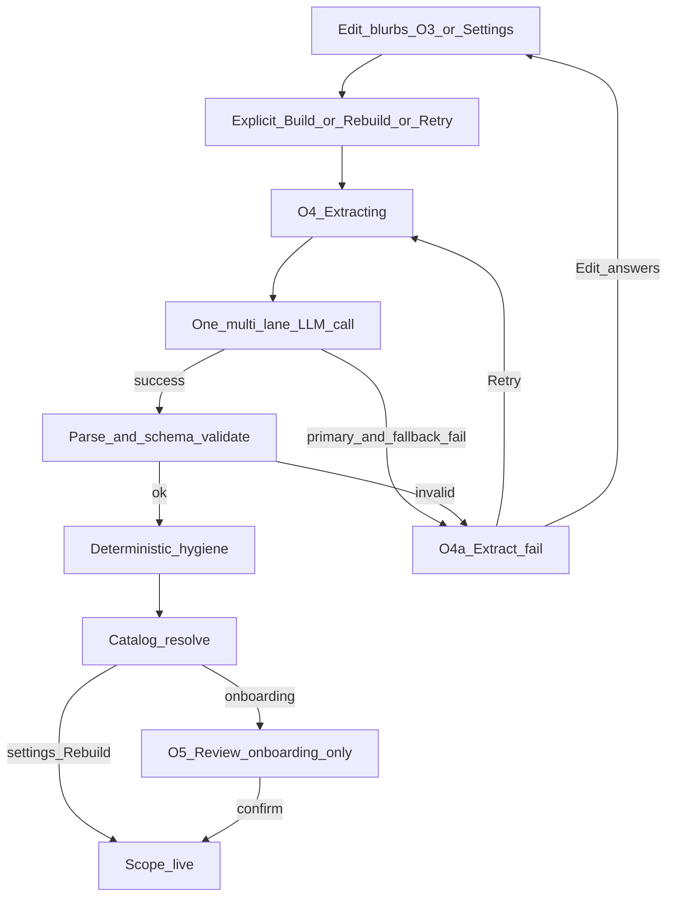

# Extraction — pipeline / runtime SoT

> **Stage:** Extraction · **Status:** Locked (Session C) · **Last updated:** 17 Oct 2026  
> **Altitude:** Engineer pipeline SoT (pre-runtime). Does **not** duplicate prompt text — see [prompts/extraction.md](../prompts/extraction.md).

**Related**

- Product contract: [extraction.md](../../../02-product/contracts/extraction.md)
- Onboarding UX (Review gate): [onboarding--v1.md](../../../02-product/prds/onboarding--v1.md)
- Prompt SoT (`extraction-v1`): [prompts/extraction.md](../prompts/extraction.md)
- Product data ERD: [tempo.dbml](../data/tempo.dbml) · [Database library](https://dbdiagram.io/d/6ab4852e58694256127b2a37)
- Extraction runs (Session D, locked): [extraction-runs.dbml](../data/extraction-runs.dbml) · [dbdiagram](https://dbdiagram.io/d/Extraction-runs-6ab952050f25a52d011d406d)
- UX happy path: [Paper — Onboarding](https://app.paper.design/file/01M22V20HEDY4VAA8Y5S3FSP9T/4-0/70H-0)
- UX extract fail: [O4a · Extract fail](https://app.paper.design/file/01M22V20HEDY4VAA8Y5S3FSP9T/5-0/IB7-0)
- Pattern: stage pipelines live at `06-engineering/docs/pipelines/{stage}.md`

---

## 1. Purpose

Orchestrate **when** extraction runs, **what happens** on success/failure, how chips **merge** with user edits, and which **behavioral signals** we keep — without owning prompt wording or the runs schema.

---

## 2. Happy path (sequence)

| Step | Rule |
|------|------|
| Trigger | **Explicit only:** onboarding **Build my scope** / **Build anyway**; O4a **Try again**; Account Context **Save** (persist + rebuild); Account a03g **Try again**. Field edits alone do **not** call the LLM. |
| Blurb edits before trigger | User may change **1–5** blurbs. No requirement to touch all five. |
| LLM payload | **Always multi-lane:** all **currently filled** blurbs in one call ([prompt SoT](../prompts/extraction.md)). |
| Success UI — **onboarding** | **Review required** (O5) before scope is live. |
| Success UI — **Account** | **No Review surface.** Apply merge (§4) and update live chips. Operator removes unwanted tags in Account Tags. |
| Failure UI | Onboarding: **[`O4a · Extract fail`](https://app.paper.design/file/01M22V20HEDY4VAA8Y5S3FSP9T/5-0/IB7-0)**. Account: **a03g** (dual-mode write \| extract — [account--v1.md](../../../02-product/prds/account--v1.md)). Do not pretend extract succeeded. |
| Empty-but-valid extract | Onboarding: Review empty/thin states (e.g. `O5a`), not extract-fail. Account: apply empty merge (no new chips); keep prior live chips. |

**Account trust rule:** Live chips must not change from **blurb field edits alone**. Context **Save** is the explicit rebuild commit (write blurbs → invoke `rebuild`). After success, new extracts **merge in** (add / resurrect per §4); prior T/K/G/Press/Platforms chips are **not** auto-dropped. Operator prunes in Tags — no second Review product for MVP ([account--v1.md](../../../02-product/prds/account--v1.md) · [model--extraction--v1.md](../../../02-product/prds/model--extraction--v1.md)).

**Deferred:** single-lane LLM call when only one settings blurb changed. Not in v1.

---

## 3. Post-model order (success path)

1. **Parse / schema-validate** lane-keyed JSON (`extraction-v1` shape).  
2. **Deterministic hygiene** (trim, length/list caps, normalize labels, geo≠keyword strip, noise denylists, additive pattern hints — detail owned by build; catalog of rules can grow without bumping prompt version unless instructions change). Within one lane, after normalize, if the same string is in both `topics` and `keywords`, **keep the topic and drop the keyword**. Personal and organization lanes stay separate, so the same string may exist on both with different `source` values.  
3. **Catalog resolve** — Model never emits UUIDs. Match `function_label` → `functions.name` → `function_id`; treat `organization_submitted` as alias → `organizations` → `organization_id`; facet/press/X normalize per [tempo.dbml](../data/tempo.dbml). Unresolved FKs may be null pending ops.  
4. **Onboarding only:** present Review chips (canonical forms the user will confirm).  
5. **Commit:** onboarding on **Confirm** (Start monitoring / warm accept); settings **immediately** after resolve — apply merge rules (§4) and mark scope live / update memberships.

Hard failure at (1) (or equivalent unusable payload) → same as LLM failure → **O4a** (or settings fail equivalent).

---

## 4. Chip merge / re-extract (from product DBML)

Adopt [tempo.dbml](../data/tempo.dbml) / [data README](../data/README.md), with the **MVP Account amend** from [onboarding--v1.md](../../../02-product/prds/onboarding--v1.md):

| Event | Behavior |
|-------|----------|
| Extract proposes item | INSERT/upsert join with `origin = extracted` |
| User removes chip | `deleted_at` + `end_reason = user_removed` |
| User adds chip | `origin = user_added` (or clear end on same PK) |
| Re-extract drops an `extracted` item (T/K/G/Press/Platforms) | **MVP: do not auto-drop** — keep prior chips; `superseded` unused in these product flows |
| Re-extract proposes again after `user_removed` | **Resurrect** (clear `deleted_at` / `end_reason`) |
| `user_added` on re-extract | **Untouched** |
| Stakeholders | Extract-only (no Add/x); drop → `deleted_at` (schema may still use `superseded` here / later) |
| Active scope | `deleted_at IS NULL` |
| Eval reject signal | `extracted` + `user_removed` |

---

## 5. Behavioral signals map

| UX event | Label meaning | Stored how (target) |
|----------|---------------|---------------------|
| Extract proposes chip | Model suggestion | `origin = extracted` |
| User removes chip | Reject | `user_removed` |
| User adds chip | Fill gap / preference | `user_added` |
| Re-extract would drop extracted (T/K/G/Press/Platforms) | MVP: no-op keep | Prior row stays active |
| Re-extract resurrects after remove | Model proposes again | Clear `deleted_at` |
| Leave chip unchanged through Review | Soft accept (onboarding) | No row change |
| O4a Retry | Infra/model failure recovery | Runs row `failed`, then new run |
| Confirm Review → live | Scope committed (onboarding) | Pipeline milestone / run `accepted_at` |
| Account Context Save success | Scope updated without Review | Merge applied; run `accepted_at` on successful merge |

Per-run model metadata → [extraction-runs.dbml](../data/extraction-runs.dbml). Each extract **attempt** must write a run record once migrated to Supabase.

---

## 6. Runtime gap (build phase)

This pipeline describes the **target** (five blurbs, multi-lane call, onboarding Review, settings add-only merge, O4a, DBML joins). Live prototype may still use a single-narrative extract into a settings blob until reconcile. Do not assume five-lane migrations already ship.

---

## 7. Out of this document

- Prompt instructions / JSON field semantics → [prompts/extraction.md](../prompts/extraction.md)
- Product intent / non-goals → [contracts/extraction.md](../../../02-product/contracts/extraction.md)
- Onboarding Review UX → [onboarding--v1.md](../../../02-product/prds/onboarding--v1.md) · Paper O5
- Eval / gold → Session E
- Production chip-efficacy reports → later analytics (join runs ↔ memberships)
- Account Tags / Context prune UX → Account / design SoT (no Review gate)

---

## Decision log (Session C)

| Date | Lock | Choice |
|------|------|--------|
| 27 Sep 2026 | Path | `06-engineering/docs/pipelines/extraction.md` |
| 27 Sep 2026 | Fail-closed | Persist blurbs; O4a; no Review on call failure |
| 27 Sep 2026 | Merge | DBML rules as written (incl. resurrect) |
| 27 Sep 2026 | Triggers | Explicit Build/Rebuild/Retry; edit 1–5 blurbs OK; always full multi-lane on filled set |
| 27 Sep 2026 | Post-model | Validate → hygiene → resolve → (Review if onboarding) |
| 27 Sep 2026 | Signals | Behavioral map above; run schema → Session D (`extraction runs`) |
| 27 Sep 2026 | Deferred | Single-lane settings extract |
| 17 Oct 2026 | Review gate | **Onboarding only.** Account Rebuild applies merge live; no second Review UI ([account--v1.md](../../../02-product/prds/account--v1.md)). |
| 17 Oct 2026 | Account merge | T/K/G/Press/Platforms: no auto-drop on re-extract; operator removes in Tags. |
| 17 Oct 2026 | Account Save | Persist + rebuild (not blurb-edit-alone). Invoke table → [model--extraction--v1.md](../../../02-product/prds/model--extraction--v1.md). |
| 17 Oct 2026 | a03g | Dual-mode fail (`fail_kind` client-only); generic MVP copy. |
