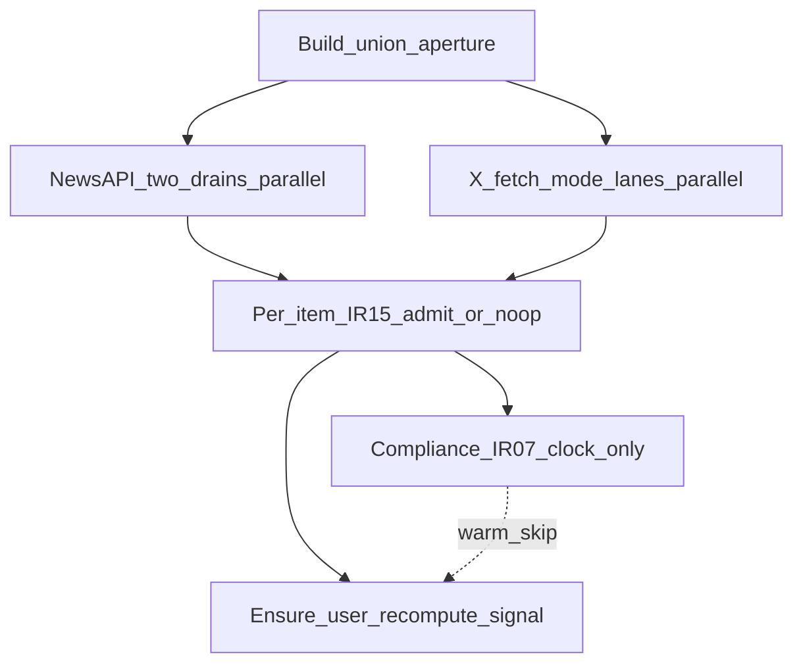

# Ingestion — pipeline / runtime SoT

> **Stage:** Ingestion · **Status:** Locked (B1) · **Last updated:** 29 Oct 2026  
> **Altitude:** Engineer pipeline SoT (pre-runtime). Product rules live in the [contract](../../../02-product/contracts/ingestion.md) — this file owns jobs, triggers, sequences, data binds, failure matrix, and observability pointers. No LLM prompt or gold ownership.

**Related**

- Product contract: [ingestion.md](../../../02-product/contracts/ingestion.md) (locked)
- Vendors: [api-newsapi-ai.md](../api-newsapi-ai.md) · [api-x.md](../api-x.md)
- Invoke targets: [summarization.md](./summarization.md) · [story-tagging.md](../../../02-product/contracts/story-tagging.md) · [metastory.md](./metastory.md)
- UX triggers: [onboarding--v1.md](../../../02-product/prds/onboarding--v1.md) · [account--v1.md](../../../02-product/prds/account--v1.md)
- Feed join / cutover UX: [dashboard--v1.md](../../../02-product/prds/dashboard--v1.md)
- Data: [tempo.dbml](../data/tempo.dbml) · [Database library](https://dbdiagram.io/d/6ab4852e58694256127b2a37)
- Ops pricing: [07-ops/README.md](../../../07-ops/README.md) · planned `ingestion-pricing.json` (sibling to [model-pricing.md](../../../07-ops/model-pricing.md))
- Pattern: stage pipelines live at `06-engineering/docs/pipelines/{stage}.md`

---

## 1. Purpose

Orchestrate **when** shared-pool ingestion runs, **how** clock / warm / IR-14 jobs sequence, **admit** + same-tick consumer barriers, and **what** we observe for ops cost — without owning article-summary or story-chip prompts/gold, metastory writer logic, dashboard join UX, or Database library column definitions.

---

## 2. Jobs and triggers

Three Tempo jobs (modular monolith). User join/personalization recompute is a **signal** from warm/clock handoff — not a fourth ingestion job.

| Job | Cadence / trigger | Does |
|-----|-------------------|------|
| **Shared clock** | Every hour at **`:00`** | Union aperture → NewsAPI two drains + X lanes → admits → **compliance** (IR-07) |
| **Warm** | UX event (below) | Widen → shared fetch + admits + ensure user recompute; narrow/unchanged → **recompute only** (no shared fetch, no compliance) |
| **X edit re-read** | Every **15 min** at **`:10 / :25 / :40 / :55`** | IR-14 Get posts by ids → text replace → story-tagging re-invoke on change |

### 2.1 Warm UX map

Warm runs **after successful scope commit** on Account paths; onboarding Start / o05e re-trigger warm per PRD.

| Surface | CTA | Ingestion |
|---------|-----|-----------|
| **o05** | Start monitoring → | Warm trigger accepted → **always widen** + shared fetch |
| **o05e** | Try again → | Re-trigger warm (ensure/restart) |
| **a02a / a02g** (Tags) · **a03a / a03f** (Context) | Save | After **successful scope commit** → widen diff → shared fetch if widen; always ensure that user’s recompute |
| **a02i** (Tags) · **a03g** (Context) | Try again | After **successful scope commit** (recover) → same as Save |

Unchanged sign-in: last-good feed until clock ([dashboard](../../../02-product/prds/dashboard--v1.md) · IR-10). Screens/copy → PRDs / Paper — not duplicated here.

### 2.2 Widen vs narrow (Item 2)

Compare previous vs next **live confirmed** aperture: traditional `sourceUri`, topic/geo `conceptUri`, keyword string, X handle, `fetch_mode`.

- **Widen:** any add, or any `fetch_mode` change, or Start monitoring → shared fetch + user recompute  
- **Narrow / unchanged:** removals only or no set change → **no** shared fetch; still ensure user recompute; **no** pool GC (IR-16)

Union aperture contributors: **all accounts with live confirmed scope** (IR-01).

---

## 3. Shared-fetch tick sequence

Applies to **clock** and **warm-on-widen** (not IR-14).

| Step | Rule |
|------|------|
| 1. Aperture | Union of live confirmed scopes |
| 2. Vendors | Two NewsAPI Stream drains (concepts \| keywords); X `word_search` / `post_download` by `fetch_mode`; lane-fail → degrade that lane |
| 3. Per item | IR-15: new admit / resurrect → §4; active duplicate → no-op |
| 4. Compliance | **Clock only**, after fetch/admit; fail → keep pool; retry next `:00` |
| 5. Warm | Steps 1–3 + user recompute; **no** compliance |

Empty aperture → no vendor fetch; no invented scope.

---

## 4. Per-admit path and body custody

**New admit** = first active pool membership for press `uri` / X post id, or soft-removed **resurrect**.

### Press (body present)

1. Persist keep-list **first** (no body)  
2. Fan-out same-tick consumers (**order flexible / parallel OK**): summarization · story-tagging · metastory handoff  
3. **Barrier** — wait for each **invoked** consumer’s terminal signal (success \| fail-open \| skip)  
4. Discard body  

### Press (no body)

Persist → **skip** summarization → story-tagging (title only) → metastory → nothing to discard.

### X

Persist keep-list (`text` is the record) → story-tagging on `text` → metastory (no summarization).

### Active duplicate (IR-15)

No summarization, no story-tagging, no metastory-admit; **no** MVP keep-list metadata refresh.

Every new admit is handed to metastory **same tick**, including zero chips / tagging failure (chips gate **feed join**, not clustering).

---

## 5. AI invoke boundaries

Ingestion **orchestrates** only. Sibling stages own prompts, retries (≤2), and column writes.

| Target | Passes | Waits for | Must not |
|--------|--------|-----------|----------|
| **Summarization** | `story_id`, `uri`, title, body in memory, trigger id | success \| fail \| skip (no body) | Write `article_summary`; discard body alone; invent summary |
| **Story-tagging** | `story_id`, kind, text (title+body \| title \| X text), trigger id (+ IR-14 reason) | success \| fail | Write `story_*`; invent chips |
| **Metastory** | Admitted `story_id`(s); body handle if still in memory; tick id | Handoff completion / degrade for **this** handoff | Run embeddings/writer; gate on chips |

---

## 6. IR-14 (edit re-read)

| Lock | Value |
|------|--------|
| Cadence | `:10 / :25 / :40 / :55` (clear of clock `:00`) |
| Eligibility | `x_posts` with `published_at` still inside ~**30‑min** vendor edit window |
| Call | Chunked `Get posts by ids`; upsert `text` when changed → re-invoke story-tagging |
| Cap | **No MVP $-cap**; window + chunking only; fail-open keep prior text |
| Pricing | Usage facts → PostHog; $ in daily digest (§8) |

---

## 7. Data map (existing tables only)

Field-level SoT: [tempo.dbml](../data/tempo.dbml) / [Database library](https://dbdiagram.io/d/Database-library-6ab4852e58694256127b2a37). Pipeline does **not** redefine columns. Missing field → ERD change, not invent here.

| Job / step | Reads | Writes |
|------------|-------|--------|
| Aperture / widen diff | Live scope memberships (all live confirmed users) | None |
| NewsAPI drains | `newsapi_drain_cursors`; aperture sets | Cursor advance on success |
| X lanes | `x_word_search_cursor`; `x_post_download_cursors`; handles + `fetch_mode` | Those cursors on success |
| Admit keep-list | `stories` + subtype by `uri` / post id | Upsert `stories` + `press_articles` \| `x_posts` (no body); resurrect clears `removed_at` |
| Summarization / tagging / metastory | Invoke only | **Sibling stages** write `article_summary`, `story_*`, metastory tables |
| Compliance | Active X ids/authors; `x_compliance_jobs` | Job rows; soft-remove `stories.removed_*` |
| IR-14 | `x_posts` in window | Upsert `text` when changed |
| Warm recompute | Triggering `user_id` | Signal only — join/personalization tables not owned here |

**Not ingestion metering:** cursors / compliance jobs = **pipeline state**, not cost facts (§8).

---

## 8. Failure / degrade / idempotency

| Failure | Behavior |
|---------|----------|
| One NewsAPI drain fails | Degrade that drain; other drain + X continue |
| One X lane / handle fails | Degrade that lane/handle; others continue |
| Empty aperture | No vendor fetch |
| Summarization fail/skip | Keep-list stays; still tag + metastory; no body store |
| Story-tagging fail | Story stays; still metastory; no invented chips |
| Metastory handoff degrade | Body discarded after barrier; keep-list kept; cluster retry per metastory rules |
| Compliance fail/expired | Pool unchanged; retry next `:00` |
| IR-14 lookup fail | Keep prior `text`; retry next IR-14 slot |
| Active duplicate | No-op (idempotent) |
| Warm trigger fail (o05e) | No onboarding scope confirm until warm accepts |
| Clock/warm overlap | Idempotent admits (IR-15); cursors advance only on lane success |

**Idempotency keys:** press `uri`, X post id, IR-14 text equality, cursor watermarks.

---

## 9. Observability and cost

### 9.1 PostHog (usage facts)

Family: **operational efficiency** (metering + job health) — not UX funnels (those live on onboarding/dashboard walks). No LLM eval/gold for this stage.

| Event | When | Properties (no body/text PII) |
|-------|------|-------------------------------|
| `ingestion_job_completed` | End of clock / warm-widen / IR-14 / compliance attempt | `job_kind`, `ok` \| `degraded`, `duration_ms`, counts (`articles_returned`, `ids_requested`, `ids_returned`, `text_changed`, …), `lanes_degraded[]`, `trigger` |

No per-article PostHog events. No new Supabase usage table in v1.

### 9.2 Unit prices (weekly)

- SoT: [ingestion-pricing.json](../../../07-ops/ingestion-pricing.json) (+ [md](../../../07-ops/ingestion-pricing.md)) — envelope like [model-pricing](../../../07-ops/model-pricing.md)  
- **Mondays 14:00 UTC** with models; channel **`#ops-pricing-ingestion`** · secret `TEMPO_OPS_SLACK_WEBHOOK_URL_INGESTION`  
- Intent: auto doc-fetch → **diff** → Slack (`in_sync` / `drift` / `fetch_fail`) → **human merge**; always post Monday heartbeat  
- Do not fetch prices on ingest runs; do not auto-write SoT without human merge  
- X `usage` / `credits` = **later actuals reconcile**, not the rate-card SoT  
- Workflow: [weekly-pricing-catalog-review.yml](../../../.github/workflows/weekly-pricing-catalog-review.yml) · [D-086](../../DECISIONS.md)

### 9.3 Daily spend digest

- Channel: **`#ops-pricing-ingestion`** · **daily 14:00 UTC** (same hour as weekly / model digests)  
- Lead: **estimated $/day**; then $/run (or avg) and breakdown by `job_kind`  
- Per-call detail optional/collapsed  
- Formula: yesterday’s PostHog facts × stamped rates (`price_as_of`)  
- **No MVP $-caps** on vendor calls  
- Workflow: [daily-ops-spend.yml](../../../.github/workflows/daily-ops-spend.yml) (shell until PostHog + SKUs wired)

Model daily spend (from `*_runs.estimated_cost_usd`) → `#ops-pricing-models` via the same daily workflow — see [07-ops/README.md](../../../07-ops/README.md).

---

## 10. Runtime gap (build phase)

**Target:** NewsAPI.ai Stream + X per vendor docs; jobs and admits as above.

**Today’s prototype** may still use RSS / local feed-reader paths. Treat as **legacy** until build reconciles. Do not treat RSS allowlists as the product aperture.

---

## 11. Out of this document

- Product IR rules / In-Out → [contracts/ingestion.md](../../../02-product/contracts/ingestion.md)  
- Vendor field matrices → [api-newsapi-ai.md](../api-newsapi-ai.md) · [api-x.md](../api-x.md)  
- Summarization / story-tagging / metastory prompts, gold, runs → sibling pipelines / PRDs / evals  
- Dashboard join, last-good, rising formulas → [dashboard--v1.md](../../../02-product/prds/dashboard--v1.md)  
- Column-level ERD → [tempo.dbml](../data/tempo.dbml)  
- Slack failure paging / runbooks → later platform ops  
- GHA workflow implementation for digests and auto-diff → post-lock ops pass  
- Model daily cost digest → `07-ops` (after ingestion digest spec)

---

## Decision log (B1)

| Date | Lock | Choice |
|------|------|--------|
| 29 Oct 2026 | Jobs | Three jobs: clock `:00`, warm (UX), IR-14 `:10/:25/:40/:55` |
| 29 Oct 2026 | UX warm | o05 / o05e / Account Save+Try again (a02* Tags, a03* Context) after successful scope commit |
| 29 Oct 2026 | Widen | Set diff; Start always widen; `fetch_mode` change = widen |
| 29 Oct 2026 | Shared-fetch sequence | Fetch → admit → compliance clock-only |
| 29 Oct 2026 | Admit | Persist → fan-out → barrier → discard; always hand metastory |
| 29 Oct 2026 | AI fences | Thin invoke I/O; siblings own writes |
| 29 Oct 2026 | IR-14 | 15‑min offsets; no MVP $-cap |
| 29 Oct 2026 | Data | Thin job→table map; cursors ≠ metering |
| 29 Oct 2026 | Failure matrix | Fail-open pool; active duplicate no-op |
| 29 Oct 2026 | Cost / PostHog | `ingestion_job_completed`; `ingestion-pricing`; daily `#ops-pricing-ingestion`; weekly auto-diff+human with models |
| 29 Oct 2026 | Artifact | **Locked** — this file |
