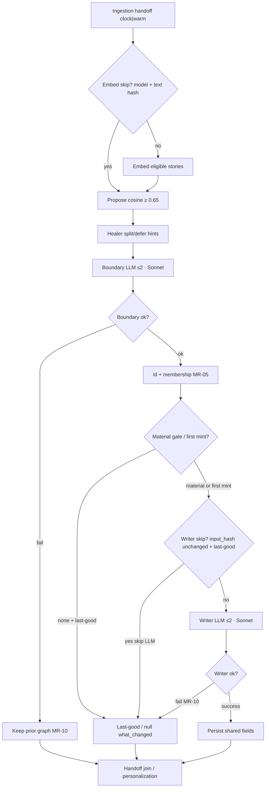

# Metastory — pipeline SoT

> **Stage:** Metastory · **Status:** B3 design **Locked** (pipeline L1–L9 + DB/DBML D-106) · **Last updated:** 3 Nov 2026  
> **Altitude:** Engineer pipeline for embed → cluster propose → boundary LLM → shared writer LLM. One pipeline owns both generative calls. Prompt text and gold live in siblings — this file owns sequence, gates, timeouts/observability, and carry posture.

**Related**

- Product contract: [metastory.md](../../../02-product/contracts/metastory.md) (locked)
- Model PRD: [model--metastory--v1.md](../../../02-product/prds/model--metastory--v1.md)
- Prompts: [metastory-boundary.md](../prompts/metastory-boundary.md) · [metastory-writer.md](../prompts/metastory-writer.md)
- Evals: [metastory-boundary.md](../evals/metastory-boundary.md) · [metastory-writer.md](../evals/metastory-writer.md) · [index](../evals/metastory.md)
- Runs: [metastory-runs.dbml](../data/metastory-runs.dbml) (Locked B3 · D-106) · [dbdiagram](https://dbdiagram.io/d/6ae28fb1ed134e407e37a484)
- Product ERD: [tempo.dbml](../data/tempo.dbml) §§8–9 (B3 amend D-102 · D-094) · [Database library](https://dbdiagram.io/d/6ab4852e58694256127b2a37)
- Upstream: [ingestion.md](./ingestion.md) · [summarization.md](./summarization.md) · [story-tagging.md](./story-tagging.md)
- Legacy prototype (not product SoT): [what-changed-spec.md](../what-changed-spec.md) · `cluster-v4` / refresh megapipe
- Pattern: sibling [extraction.md](./extraction.md)

---

## 1. Purpose

Form **event-grained** shared metastories from tagged pool stories: embed → propose → boundary → id/membership → writer. Do not own join/rank, story chips, why/what-next, or feed caps.

---

## 2. Happy path (sequence)

| Step | Rule |
|------|------|
| Trigger | **`clock` \| `warm`** only ([D-098](../../DECISIONS.md)) — ingestion handoff; new admits inherit the parent job kind. **No `x_edit`** (IR-14 → story-tagging only) |
| 1. Embed | Eligible text per [MR-04](../../../02-product/contracts/metastory.md) → `story_embeddings` **`vector(1536)`**; model **`text-embedding-3-small`** via `TEMPO_OPENAI_EMBEDDING_MODEL` (shared with recall; D-094). Skip when embed model + `embedded_text_hash` unchanged. **Not** a chat LLM; **no** `metastory_runs` row; priced from [model-pricing.json](../../../07-ops/model-pricing.json) |
| 2. Cluster propose | Vector similarity among **already admitted** stories ([MR-03](../../../02-product/contracts/metastory.md)); advisory cosine link floor **`0.65`** (`TEMPO_METASTORY_PROPOSE_MIN_COSINE`, D-096) — env-tunable; not product law until gold promotes |
| 3. Deterministic repair | Split/defer healer **only** (hints → boundary): geo alone ≠ merge; weak geo-stripped overlap → split signal; prefer defer/ambiguous over wrong atomize. Advisory split Jaccard **`0.22`** (`TEMPO_METASTORY_HEALER_SPLIT_JACCARD`, D-096). **No election-bundle Jaccard / min-shared path** — continuous-event continuity → boundary prompt + gold (**B-F3**). Triggers ≠ `claim_evidence_map` (carry P10 = D). Healer does **not** invent merges |
| 4. Boundary | ≤2 attempts ([MR-10](../../../02-product/contracts/metastory.md)); **SKU `anthropic:claude-sonnet-5-5`** (D-095; same model on retry; no Opus); confirm / split / merge at event grain → `metastory_runs` (`call_kind=boundary`) |
| 5. Id / membership | UUID continuity when event continues ([MR-05](../../../02-product/contracts/metastory.md)); **+n/−n** membership OK; soft M:N; mint only after successful writer persist (**title+subtitle+what_happened** — [D-102](../../DECISIONS.md)). Prefer fragment over ambiguous merge. As-is Jaccard/hash = **signals/evals**, not public id |
| 6. Shared-run material gate | When prior shared run exists: cheap deterministic “anything material?” (membership + stable stored evidence + prior shared copy). **None** → keep last-good / do not invent delta. First mint → writer must return **title+subtitle+what_happened**; `what_changed` may be null ([D-102](../../DECISIONS.md)) |
| 7. Writer | ≤2 attempts; **SKU `anthropic:claude-sonnet-5-5`** (D-095); persist **title+subtitle+what_happened** required ([D-102](../../DECISIONS.md)); `what_changed` null OK **first mint only**; empty required fields → fail attempt → `call_kind=writer`. Prefer **prior title text** unless rename/rewrite warranted |
| 8. Fail paths | Per [MR-10](../../../02-product/contracts/metastory.md): boundary fail → prior graph; writer fail → last-good if any; new event + writer fail → no row / no membership |
| Handoff | Join / feed membership → personalization / dashboard |

### Thresholds (advisory — D-096)

| Knob | Advisory default | Env | Notes |
|------|------------------|-----|-------|
| Propose cosine link floor | **0.65** | `TEMPO_METASTORY_PROPOSE_MIN_COSINE` | Candidate gen among admitted stories only; boundary judges |
| Healer split Jaccard (geo-stripped) | **0.22** | `TEMPO_METASTORY_HEALER_SPLIT_JACCARD` | Hint only; fail closed / defer > false merge |
| Election-bundle Jaccard / min-shared | **None** | — | Dropped for to-be; continuity = boundary + [evals B-F3](../evals/metastory-boundary.md) |

Calibrate via boundary gold before treating as frozen. Distinct from recall `TEMPO_EMBED_MIN_SIMILARITY`.

### Evidence cap & ranking (D-097)

| Layer | Policy |
|-------|--------|
| Persisted membership (`metastory_stories`) | **Uncapped** — all same-event members may attach |
| LLM evidence (boundary / writer / healer input) | Cap **`12`** per metastory per tick (`TEMPO_METASTORY_EVIDENCE_CAP`) |
| Overflow (rank 13+) | **Stay on graph**; **omit from LLM prompts** this tick |
| UI source list / “+N more” | **Dashboard** — not this pipeline |

**Rank (composite, advisory weights — normalize each signal ≈0–1):**

| Signal | Weight |
|--------|--------|
| Recency (`published_at`) | **0.35** |
| Embed similarity to cluster centroid | **0.40** |
| Outlet novelty (prefer unseen outlets in the selected set) | **0.15** |
| Evidence richness (e.g. `article_summary` present) | **0.10** |

Stable tie-break: `story_id`. Tune weights/cap via evals if missing outlets or mushy copy — same posture as D-096.

### Idempotency keys (D-099)

Aligns with summarization / story-tagging: **hash = SHA-256 hex of exact UTF-8 bytes sent** (no extra normalize); system prompt covered by `prompt_version`. Publisher body is **never** a runs column — only hashed when it was part of the **writer** payload as sent ([MR-08](../../../02-product/contracts/metastory.md)).

| Step | Skip / short-circuit | Lineage | Key |
|------|----------------------|---------|-----|
| Embed | Skip when **embed model id** + **`embedded_text_hash`** unchanged | No `metastory_runs` row | `story_embeddings.model` + `embedded_text_hash` |
| Propose / heal | Pure functions of current embeddings + membership; safe to recompute | No runs row | Deterministic from vectors + healer knobs (D-096) |
| Boundary invoke | One invoke per metastory candidate set per tick; retries share `trigger_id` | Row per attempt (`call_kind=boundary`) | `trigger_id` (new UUID per invoke) · `trigger_kind` · `input_hash` = SHA-256 of **canonical boundary payload as sent** (ranked ≤12 member evidence + repair hints + prior membership ids; **no** body bytes — boundary is not an MR-08 consumer) |
| Material gate | **None** + last-good exists → **no writer LLM** | No writer row | Gate inputs: membership diff + stored evidence signatures + prior shared copy fingerprint |
| Writer invoke | **Skip LLM** when `input_hash` unchanged **and** last-good shared copy exists | No row on skip; row per attempt when called | `trigger_id` · `call_kind=writer` · `input_hash` = SHA-256 of **canonical writer payload as sent** (≤12 evidence incl. optional `same_tick_body` for new press still in memory + prior shared fields + gate outcome; **never** store body) |
| Fail | Boundary fail → prior graph; writer fail → last-good / no blank mint ([MR-10](../../../02-product/contracts/metastory.md)) | Failed attempts still recorded | — |

`trigger_id` groups primary + retry for one `call_kind` within one tick. Do not reuse `trigger_id` across boundary vs writer.

**Out of this pipeline:** drains; story-chip apply; why/what-next; rising/feed caps; beat-fit pre-cluster; user watermark; per-user ever-seen what-changed.

---

## 3. Caps and budgets

| Limit | Owner | Status |
|-------|--------|--------|
| Sources / membership vs LLM evidence | **This stage** | **D-097:** membership **uncapped**; LLM evidence cap **12** (ranked); UI source-list → dashboard |
| Metastories shown / overflow / thin-on-beat | **Dashboard** | B5 carry — not here |
| Global “max events in Tempo” | **None** | No product cap |
| Per-tick LLM/embed work budget | **Ops (this stage)** | **Parked (D-100)** — not MVP; reopen on staging load / cost |
| Deferred recluster pass | **Ops (this stage)** | **Parked (D-100)** — hard cases → boundary+gold for MVP; no async pass |
| Skip-if-unchanged / input_hash writer short-circuit | **This stage** | **Locked D-099** — see idempotency keys; budget may add stricter skips later |
| User refresh watermark | **Dashboard / refresh ops** | Parked — not copy meaning |

---

## 4. Language and evidence

- Shared outputs: **English** ([MR-07](../../../02-product/contracts/metastory.md)).
- Sources may be EN / ES / other — language does **not** gate membership.
- Prefer English-leaning inputs when present (`article_summary`, upstream normalized text); title-only / X text may still be non-English — model must still emit English shared copy.
- Material gate compares **stable stored** fields (ids, titles, summaries) — not re-translated strings run-to-run.
- Metastory does **not** own a translator stage.

---

## 5. MVP carry-over (as-is → to-be)

### 5.1 In this stage (locked posture)

| Carry | Disposition |
|-------|-------------|
| Decompose monolithic `cluster-v4` | Embed → propose → boundary → writer by concern — not one mega-prompt |
| Event-grain / geo≠merge / election bundle | Boundary + adapted deterministic repair |
| Id continuity lessons (+n/−n, prefer fragment) | UUID + MR-05; not evidence-hash public ids |
| `summary` | → `what_happened` |
| Shared what-changed | Prior vs **current shared run** ([MR-09](../../../02-product/contracts/metastory.md)) — not ever-seen / “your last refresh” |
| False-positive-first / fail-closed | Material gate + last-good; never invent merges or spurious deltas |
| English synthesis from multilingual sources | §4 |
| ≤2 per call_kind | MR-10 |
| No runtime `factual_claims` / map | Grounding = **P0 writer eval** only |

### 5.2 Closed elsewhere (do not reopen)

| As-is | Home |
|-------|------|
| `meta-story-tags` / settings lexical+semantic | [story-tagging](./story-tagging.md) carry — retired as ST SoT |
| Chips ≠ metastory id; no `metastory_chips` | Contract MR-02 + tempo ERD |

### 5.3 Forward parking lot (not metastory locks)

| As-is | Forward home | When |
|-------|--------------|------|
| Beat-fit pre-cluster / input cap / social quota | Dashboard feed prep | B5 |
| Overflow / thin-on-beat / survival rank | Dashboard | B5 |
| Rising / source-rail order | Dashboard | B5 |
| Join → feed membership | Dashboard | B5 |
| Why / what next / doctrine | Personalization | B4 |
| `associated_entities` for rank | Dashboard if still needed | B5 |
| Watermark short-circuit | Dashboard / refresh ops | B5 |
| Prototype `embedding-recall` / `source-matcher` | Not Tempo ingestion — join / feed prep ([personalization carry](./personalization.md) §3.4) | B5 |

### 5.4 Legacy do-not-port as product meaning

- User-relative 3-state what-changed engine as `metastories.what_changed`
- Freshness template as change signal
- Max-5 meta-stories as shared-pool law
- Cluster output tags / claims as persisted metastory columns
- `generateMetaStoryId` hash as public identity

---

## 6. Timeouts, concurrency, observability

| Knob | Default | Env (build) |
|------|---------|-------------|
| Per-attempt timeout (boundary **and** writer) | **15000** ms (ceiling; shared default with extraction + summarization + story-tagging + personalization) | `TEMPO_AI_METASTORY_TIMEOUT_MS` |
| Concurrent candidate units in boundary/writer path per tick | **2** (clamp 1–4) | `TEMPO_AI_METASTORY_CONCURRENCY` |

Primary and retry for a given `call_kind` are **sequential** (same Sonnet SKU; each attempt gets its own 15s). Concurrency caps **how many candidate units / writer targets** may be in the generative path at once — distinct from parked per-tick $ budget ([D-100](#7-ops-revisit-bag)).

**Logs / metrics (allowed):** `trigger_id`, `trigger_kind`, `call_kind`, `metastory_id` (when known), `prompt_version`, model id, status, `error_kind`, token counts, latency, concurrency pool stats, evidence-cap omit counts.

**Never log (prod default):** publisher body / `same_tick_body`, full member evidence payloads, shared title/subtitle/what_happened/what_changed text, membership graphs. Optional debug flag later — off by default.

**Same-tick body (MR-08):** Writer may receive publisher body for **new** press still in memory this tick (orchestrator barrier — [IR-05](../../../02-product/contracts/ingestion.md)). Boundary prompts stay body-free. Discard after writer what-happened read + sum + ST finish — ingestion owns discard.

**PostHog:** `metastory_invoke` once per finished **LLM** invoke (`call_kind` boundary \| writer; not per attempt; not on embed/propose/heal; not on writer skip / material-gate none) — [D-088](../../DECISIONS.md) / [model PRD](../../../02-product/prds/model--metastory--v1.md); wire at build.

---

## 7. Ops revisit bag

**D-100 — parked for MVP** (not dashboard):

1. **Per-tick LLM/embed work budget** — no integers now; ≠ ≤2 retries; ≠ concurrency pool above. Reopen when clock volume / $ evidence exists.
2. **Deferred recluster** — no async second pass in MVP design. Ambiguity → fail closed / fragment + **boundary gold**; as-is deferred-recluster is residue.
3. ~~Skip-if-unchanged~~ → **D-099**.

Hard cases for MVP user value = prompt + evals, not this bag.

---

## 8. Runtime gap (build phase)

**Target:** Invoked from ingestion on clock/warm handoff as a same-tick consumer alongside summarization (if any) and story-tagging — **order flexible / parallel OK** ([IR-05](../../../02-product/contracts/ingestion.md)); embed → propose → heal → boundary → material gate → writer; persist shared fields; lineage rows; `metastory_invoke` when instrumented. Body discard only after the orchestrator barrier (incl. writer what-happened when used).

**Today:** Stage **not shipped** at runtime. Pipeline / prompts / runs DBML / evals+gold are **Locked B3**. Do **not** treat prototype `cluster-v4` / refresh megapipe / `what-changed-spec` as this SoT. Exact Sonnet SKUs: [prompts/metastory-boundary.md](../prompts/metastory-boundary.md) · [prompts/metastory-writer.md](../prompts/metastory-writer.md).

---

## 9. Decision log (MVP carry)

| Date | Lock | Choice |
|------|------|--------|
| 3 Nov 2026 | P1 | Stage boundary **C** — parking lot §5.3; closed §5.2 |
| 3 Nov 2026 | P2 | Decompose `cluster-v4` by concern **C** |
| 3 Nov 2026 | P2b | Caps split **C**; integers **D**; no global product cap |
| 3 Nov 2026 | P3 | Boundary + adapted deterministic repair **C** |
| 3 Nov 2026 | P4 | UUID + MR-05 continuity **C**; +n/−n; title text not frozen by id |
| 3 Nov 2026 | P5 | Persist four fields only **B**; title-prefer = writer rule |
| 3 Nov 2026 | P6 | Shared what-changed semantics + posture **C** |
| 3 Nov 2026 | P7 | Healer + shared-run material gate; watermark out **C** |
| 3 Nov 2026 | P8 | Multilingual sources → English shared copy **C** |
| 3 Nov 2026 | P9 | Affirm MR-10 + fail-closed posture **C** |
| 3 Nov 2026 | P10 | No runtime claims **D**; grounding P0 in writer evals |
| 3 Nov 2026 | P11 | Thin ops + strong eval intent on existing stubs **C** |
| 3 Nov 2026 | L1 | Thicken pipeline in place **A** |
| 3 Nov 2026 | L2 | Embed SKU **`text-embedding-3-small`** · `vector(1536)` · shared env **A** (D-094) |
| 3 Nov 2026 | L3a | Boundary+writer SKU **Sonnet 5.5 only** (same-SKU retry; no Opus) **C′** (D-095) |
| 3 Nov 2026 | L3b | Advisory propose **0.65** · split Jaccard **0.22** · **drop** election-bundle path **A** (D-096) |
| 3 Nov 2026 | L4 | Split ceilings **C**; membership uncapped; evidence cap **12**; weights 0.35/0.40/0.15/0.10; overflow keep+omit; UI → dashboard (D-097) |
| 3 Nov 2026 | L5 | `trigger_kind` **`clock` \| `warm`** **A** (D-098); no x_edit / admit variants |
| 3 Nov 2026 | L6 | Mermaid thickened + idempotency keys **A** (D-099) |
| 3 Nov 2026 | L7 | Ops bag budget + deferred recluster **park B** (D-100) |
| 3 Nov 2026 | L8 | Per-attempt timeout **15000** ms (`TEMPO_AI_METASTORY_TIMEOUT_MS`); concurrency **2** (clamp 1–4); PostHog `metastory_invoke` pointer (D-088) — align with extraction / summarization / story-tagging / personalization |
| 3 Nov 2026 | L9 | Writer `same_tick_body` per MR-08 / IR-05; boundary stays body-free; D-099 hash includes writer body bytes when sent (D-107) |

**B3 design Locked (D-094…D-107 + L8–L9):** pipeline L1–L9 · prompts · gold arbiter-locked · DB/DBML review. **Must coherence Closed** (SR + ST Constraints). **B4 personalization design Locked** (build deferred). Metastory build deferred.
