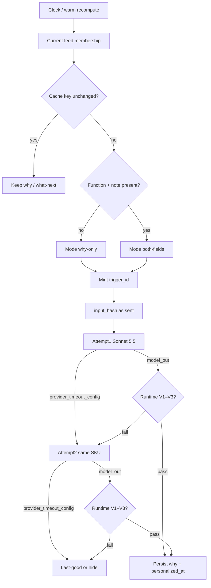

# Personalization — pipeline SoT

> **Stage:** Personalization · **Status:** B4 design Locked — build deferred (L1–L7 · PR-14 · D-108 · D-110) · **Last updated:** 5 Nov 2026  
> **Altitude:** Engineer pipeline for join-gated **why this matters** + **what comes next** (one invoke). Owns sequence, runtime validation, lineage/`input_hash`, timeouts/concurrency/observability, and carry posture. Prompt text, practice-note prose, and gold live in siblings.

**Related**

- Product contract: [personalization.md](../../../02-product/contracts/personalization.md) (locked — PR-01…14; P5; B4 C-pass)
- Model PRD: [model--personalization--v1.md](../../../02-product/prds/model--personalization--v1.md) (B4 design Locked · build deferred)
- Prompt: [personalization.md](../prompts/personalization.md) (**Locked** Pr1–Pr6) — **one** prompt SoT (why + optional what-next)
- Practice notes: [practice-notes/](../../../02-product/practice-notes/README.md) · [practice-notes.seed.json](../data/practice-notes.seed.json) v2 · [practice-notes-seed.md](../data/practice-notes-seed.md) · [tempo.dbml](../data/tempo.dbml) `practice_notes`
- Evals / gold: [personalization.md](../evals/personalization.md) · [personalization.gold.json](../evals/personalization.gold.json) (24 cases; arbiter-locked 5 Nov 2026; advisory until promote)
- Runs: [personalization-runs.dbml](../data/personalization-runs.dbml) (`trigger_kind` = `clock` \| `warm`; D-109 · D-110) · [dbdiagram](https://dbdiagram.io/d/6ae28fcfaac33014104ead45)
- Product ERD: [tempo.dbml](../data/tempo.dbml) §10 feed membership + `practice_notes` · [Database library](https://dbdiagram.io/d/6ab4852e58694256127b2a37)
- Upstream: [metastory.md](./metastory.md) · [ingestion.md](./ingestion.md)
- Downstream chrome: [dashboard--v1.md](../../../02-product/prds/dashboard--v1.md) (join, rank, share pack — B5)
- Ops pricing: [07-ops/model-pricing.json](../../../07-ops/model-pricing.json) · `#ops-pricing-models`
- Legacy (not product SoT): [why-this-matters-spec.md](../why-this-matters-spec.md) · [archived doctrine](../../../02-product/contracts/archive/why-this-matters--field-doctrine.md) · `why-this-matters-engine.mjs`
- Pattern: sibling [summarization.md](./summarization.md) · [story-tagging.md](./story-tagging.md) · [metastory.md](./metastory.md)
- Carry: [D-108](../../DECISIONS.md)

---

## 1. Purpose

Orchestrate **when** personalization runs for a user’s **current feed members**, **skip / what-next gate (PR-14)**, **same-SKU ≤2 attempts**, **runtime validation**, **persist** why (+ what-next when not gated) + `personalized_at`, **lineage**, and **concurrency** — without owning prompt wording, practice-note prose, gold, join, or feed/open chrome.

---

## 2. Happy path (sequence)

| Step | Rule |
|------|------|
| Trigger | Ingestion **clock** \| **warm** after join; `trigger_kind` = `clock` \| `warm` — **no UX** |
| Members | `user_feed_membership.ended_at IS NULL` only ([PR-01](../../../02-product/contracts/personalization.md)); fan-out under concurrency pool |
| Skip | [PR-09](../../../02-product/contracts/personalization.md) cache hit → keep copy; **no** model; **no** run row |
| What-next gate | Empty/unresolved function **or** missing practice-note body → **why-only** ([PR-14](../../../02-product/contracts/personalization.md)); else both-fields. No default function; no invent note |
| `trigger_id` | New UUID when entering **generate** path; shared by ≤2 attempts. **Stage-minted** — not inherited from ingestion or shared with summarization / story-tagging / metastory |
| Attempt 1 | Sonnet 5.5 (`TEMPO_AI_PERSONALIZATION_MODEL` / `anthropic:claude-sonnet-5-5`) + `personalization-v1` prompt (mode in user/system wire) |
| Attempt 2 | **Same SKU** only if attempt 1 hits provider/timeout/config **or** fails runtime validation (V1–V3). Max **2** LLM calls — **no** Haiku escalate |
| Success | Persist **why** + `personalization_cache_key` + `personalized_at`. **Both-fields:** persist what-next. **Why-only (PR-14):** set `what_comes_next` **NULL** on this membership (do not retain stale last-good what-next after a successful why-only regen — chrome may show empty slot / CTA). Succeeded run row(s) |
| Failure | Last-good or hide; failed run row(s) as applicable; no state templates |

---

## 3. Post-model order (per attempt)

1. Receive model output or error.
2. On provider / timeout / config error → mark attempt `failed` with `error_kind`; if attempts remain → retry same SKU; else final fail.
3. **Runtime validate** ([§4](#4-runtime-validation)): on fail → attempt `failed` (`schema_error` or `empty_response`); retry or final fail.
4. On pass → persist why + cache key + `personalized_at`; both-fields → persist what-next; why-only → **NULL** `what_comes_next`; attempt `succeeded`.
5. Final fail after ≤2 → last-good or hide ([PR-12](../../../02-product/contracts/personalization.md)).

---

## 4. Runtime validation

**Fail the attempt** (retry per §2 if attempts remain) when any of:

| ID | Condition |
|----|-----------|
| **V1** | Why empty / whitespace-only after trim; **or** (both-fields mode) what-next empty / whitespace-only |
| **V2** | Wrong shape — why-only: parseable object with required `why_this_matters`; both-fields: both keys required (exact JSON schema in [prompt](../prompts/personalization.md)) |
| **V3** | Hard prescribe denylist hit on **any present** field (case-insensitive substring) — MVP seed below |
| **V4** | Provider / timeout / config error (retry path; not text validation) |

### 4.1 Prescribe denylist (MVP seed)

| # | Pattern |
|---|--------|
| 1 | `respond now` |
| 2 | `issue a statement` |
| 3 | `must meet immediately` |
| 4 | `send this` |
| 5 | `publish now` |
| 6 | `you should email` |

Expand from gold fails; prefer false negatives over broad tokens (`should`, `must`, …).

### 4.2 Offline only (not runtime gates)

Org-voice / second-person personal-priority; soft retell of grounding; soft length why **2–3 / ~350–450**, what-next **1–2 / ~250–350**; practice-note obedience; evidence-over-framing posture → [evals/personalization.md](../evals/personalization.md) + human arbiter. **No** LLM judge in B4. **No** in-loop May rubric.

---

## 5. Lineage & hashing

| Field | Rule |
|-------|------|
| Grain | One `personalization_runs` row per LLM **attempt** |
| Skip / out-of-feed | **No** row |
| Why-only generate | **Yes** — same grain as both-fields |
| `trigger_id` | Shared by ≤2 attempts for one invoke |
| `trigger_kind` | `clock` \| `warm` — closed ([D-109](../../DECISIONS.md)) |
| `user_id` + `metastory_id` | Required |
| `input_hash` | SHA-256 hex of UTF-8 canonical payload **as sent** in the user message (excludes system prompt). **Same value** written to `user_feed_membership.personalization_cache_key` on success |
| Copy in runs | **Never** — membership why/next are SoT; no `output_json` |
| `estimated_cost_usd` | tokens × [model-pricing.json](../../../07-ops/model-pricing.json) at write; null if `model_id` missing from catalog |

### 5.1 `input_hash` canonical sections (fixed order)

Concatenate with `\n---\n` between sections. Within each section, use the **exact strings sent** to the model (prompt builder is SoT for inner delimiters; lock builder to this order):

1. **Grounding** — title, subtitle, what_happened, what_changed (empty string if null)
2. **Org priorities** blurb (or empty)
3. **Personal priorities** blurb (or empty)
4. **Function** stable id or label as sent
5. **Stakeholders** canonical payload as sent (or empty)
6. **Practice note** `id` + version as sent

No extra whitespace normalize. Practice-note **body** changes require a **version bump** so the hash moves.

---

## 6. Timeouts, concurrency, observability

| Knob | Default | Env (build) |
|------|---------|-------------|
| Per-attempt timeout | **15000** ms (shared ceiling with extraction / summarization / story-tagging / metastory — same LLM family) | `TEMPO_AI_PERSONALIZATION_TIMEOUT_MS` |
| Concurrent members per user recompute | **2** (clamp **1–4**) | `TEMPO_AI_PERSONALIZATION_CONCURRENCY` |

Attempts for one member are **sequential** (same Sonnet). Concurrency caps how many **feed members** for that user may be in the generate path at once.

**Logs / metrics (allowed):** `user_id`, `metastory_id`, `trigger_id`, `trigger_kind`, `prompt_version`, model id, status, `error_kind`, token counts, latency, concurrency pool stats.

**Never log (prod default):** why / what-next prose; grounding title / subtitle / what_happened / what_changed text; priority or stakeholder blurbs; practice-note body; full user-message payload. Optional debug flag later — off by default. (Mirrors metastory never-log of shared copy fields.)

**PostHog:** `personalization_invoke` once per finished **LLM** invoke (not per attempt; not on skip) — includes why-only — [D-088](../../DECISIONS.md) / [model PRD](../../../02-product/prds/model--personalization--v1.md); wire at build.

**Ops revisit bag (parked MVP):** per-tick / cross-user LLM $ budget — reopen when clock volume evidence exists (like metastory D-100).

---

## 7. MVP carry-over (as-is → to-be)

### 7.1 Stage boundary (P1 = B)

| In this stage (writer) | Forward / other |
|------------------------|-----------------|
| Archived why doctrine, [why-this-matters-spec](../why-this-matters-spec.md), why gold/engine, subtitle-echo ban | Join, rank, rising, `embedding-recall`, `source-matcher`, watermark → **B5 dashboard** |
| What comes next | **Greenfield** (no as-is field) |

### 7.2 In this stage (locked posture)

| Carry | Disposition | Lock |
|-------|-------------|------|
| Decompose as-is why megapipe | Thin PR-\*; dispose to prompt / eval / pipeline / do-not-port | P2 |
| Output model | Two fields; as-is why gold seeds **why** only | P3 |
| Audience | Function + practice notes (what-next); not everyone-as-comms | P4 |
| Input split | Share-safe why; function/note/stakeholders on what-next; one invoke | P5 |
| Taxonomy / state / doctrine retriever | Do-not-port runtime; posture → prompt/eval; notes replace retrieval | P6–P8 |
| Rubric | Eval/prompt; + org-voice why | P9 |
| Fallbacks | Last-good / hide; no state templates | P10 |
| Length | Soft why 2–3/~350–450; next 1–2/~250–350; B5 measure | P11 |
| Trace | Runs + membership only | P12 |
| Eng loop | One invoke; same-SKU ≤2; V1–V4 only at runtime | P13 / L2–L3 |
| Artifact shape | One prompt · one eval/gold | Artifact A |

### 7.3 Closed elsewhere (do not reopen)

| As-is / topic | Home |
|---------------|------|
| Shared what-changed / clustering | [metastory](./metastory.md) |
| Story chips | [story-tagging](./story-tagging.md) |
| Article summary | [summarization](./summarization.md) |
| Function / priorities / stakeholders | [extraction](./extraction.md) |

### 7.4 Forward parking lot (not personalization writer locks)

| As-is / adjacent | Forward home | When |
|------------------|--------------|------|
| Join predicate (source ∧ chips) | Dashboard | B5 |
| Feed rank / rising / source order / overflow | Dashboard | B5 |
| `embedding-recall` / `source-matcher` | Join / feed prep | B5 |
| Watermark / refresh short-circuit | Dashboard / refresh ops | B5 |
| Share-pack chrome | Dashboard / share wedge | B5 |
| Hard char caps / open-card measure | Dashboard ↔ prompt feedback | B5 |
| SKU / timeout / member concurrency | **Locked** this pipeline §2 / §6 (X3 / L5) | — |

### 7.5 Legacy do-not-port as product meaning

- Single-field `whyItMatters` only
- Everyone-as-comms; runtime taxonomy / intro-steady-evolving / doctrine retriever / May trace blob
- State-aware fallback templates; subtitle echo
- User-relative whatChanged driving why
- Dual prompt/eval files while one invoke remains

---

## 8. Runtime gap (build phase)

**Target:** Clock/warm → current members → skip / PR-14 what-next gate → ≤2 Sonnet → V1–V4 → persist why (+ what-next if not gated) + `personalized_at` + cache hash; runs on attempts; `personalization_invoke` when instrumented.

**Today:** Stage **not shipped**. B4 **design Locked** ([D-110](../../DECISIONS.md)) — contract, PRD, this pipeline (L1–L7 · PR-14), prompt **Locked** ([personalization-v1](../prompts/personalization.md)), practice-note seed **v2**, gold arbiter-locked (24; advisory until promote), runs `trigger_kind` closed (`clock` \| `warm`, [D-109](../../DECISIONS.md)). Do **not** treat `why-this-matters-engine` / archived doctrine / subtitle echo as live SoT.

---

## 9. Out of this document

- Prompt instructions / sampling → [prompts/personalization.md](../prompts/personalization.md) (Locked)
- Product PR table → [contracts/personalization.md](../../../02-product/contracts/personalization.md)
- Gold / failure-mode craft → [evals/personalization.md](../evals/personalization.md)
- Feed / d05 / share chrome → [dashboard--v1.md](../../../02-product/prds/dashboard--v1.md)
- Clock / warm orchestration → [pipelines/ingestion.md](./ingestion.md)

---

## 10. Decision log

### MVP carry

| Date | Lock | Choice |
|------|------|--------|
| 4 Nov 2026 | P1–P14 | Carry map — see §7; [D-108](../../DECISIONS.md) |
| 4 Nov 2026 | Encode | This file + PRD process sync |

### B4 pipeline thicken

| Date | Lock | Choice |
|------|------|--------|
| 4 Nov 2026 | L1 | Header / Related / Purpose sync **A** |
| 4 Nov 2026 | L2 | Happy path; same-SKU Sonnet ≤2; skip/notes/`trigger_id` **A** |
| 4 Nov 2026 | L3 | Post-model; runtime V1–V4; soft quality offline **A** |
| 4 Nov 2026 | L4 | Lineage; `input_hash` section order; cache key = hash **A** |
| 4 Nov 2026 | L5 | 15s; concurrency 2 (1–4); never-log prose (mirror metastory) **A** |
| 4 Nov 2026 | L6 | Runtime gap + Out **A** |
| 4 Nov 2026 | L7 | Artifact written — later closed as **B4 design Locked** (D-110; 5 Nov) |
| 5 Nov 2026 | PR-14 | Why-only path; `personalized_at` = why; V1/V2 mode-aware; no notes-block of why |
| 5 Nov 2026 | D-109 | Runs `trigger_kind` = `clock` \| `warm` |
| 5 Nov 2026 | Gold | 24 cases arbiter-locked; advisory until promote; no LLM judge |
| 5 Nov 2026 | D-110 | B4 DB/DBML design Locked; no column changes |
| 5 Nov 2026 | Status | B4 design Locked — build deferred |

**Next (build):** migrate `practice_notes` + `personalization_runs`; seed v2 import ([practice-notes-seed.md](../data/practice-notes-seed.md)); wire invoke + advisory harness; instrument `personalization_invoke`.
