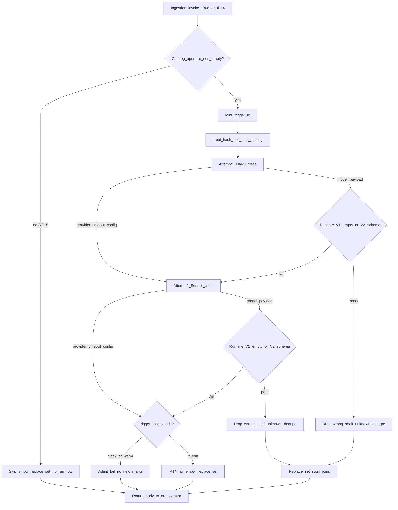

# Story-tagging — pipeline / runtime SoT

> **Stage:** Story-tagging · **Status:** Locked (B2a) · **Last updated:** 2 Nov 2026 (MVP carry-over)  
> **Altitude:** Engineer pipeline SoT (pre-runtime). Does **not** duplicate prompt text — see [prompts/story-tagging.md](../prompts/story-tagging.md) (B2a). Product meaning — [contracts/story-tagging.md](../../../02-product/contracts/story-tagging.md).

**Related**

- Product PRD: [model--story-tagging--v1.md](../../../02-product/prds/model--story-tagging--v1.md) (Spec locked B2a PRD)
- Product contract: [story-tagging.md](../../../02-product/contracts/story-tagging.md) (locked — ST-01…15)
- Prompt: [story-tagging.md](../prompts/story-tagging.md) (`story-tagging-v1` — Locked B2a)
- Evals / gold: [evals/story-tagging.md](../evals/story-tagging.md) · [story-tagging.gold.json](../evals/story-tagging.gold.json) (Locked B2a)
- Runs: [story-tagging-runs.dbml](../data/story-tagging-runs.dbml) (Locked B2a) · [dbdiagram](https://dbdiagram.io/d/6ae28fe9ed134e407e37a621)
- Ingestion orchestrator: [ingestion.md](./ingestion.md) (locked) — IR-05 body custody · IR-08 invoke · IR-14 re-tag · IR-15 active duplicate
- Parallel same-tick: summarization · metastory what-happened ([MR-08](../../../02-product/contracts/metastory.md))
- Ops pricing: [07-ops/model-pricing.json](../../../07-ops/model-pricing.json) · `#ops-pricing-models`
- Pattern: sibling [summarization.md](./summarization.md) · [extraction.md](./extraction.md)

---

## 1. Purpose

Orchestrate **when** story-tagging runs, **attempt / escalate** rules, **runtime validation**, **replace-set persistence**, **lineage**, **concurrency**, and **body borrow/return** — without owning prompt wording, gold cases, fetch drains, user-chip extraction, or metastory copy.

**Pool-wide:** every new admit (+ IR-14 text change). Join filters the feed later — this pipeline does **not** wait for metastory membership or user-visible feed.

---

## 2. Happy path (sequence)

| Step | Rule |
|------|------|
| Trigger | Ingestion [IR-08](../../../02-product/contracts/ingestion.md): every **new admit** (press or X), `trigger_kind` `clock` \| `warm`; or [IR-14](../../../02-product/contracts/ingestion.md) X text change → `x_edit` |
| Skip LLM (no run row) | Empty catalog aperture ([ST-15](../../../02-product/contracts/story-tagging.md)); IR-14 **no** text change; active duplicate (ingestion never invokes — [IR-15](../../../02-product/contracts/ingestion.md)) |
| Empty aperture | Outcome **`skip`**: empty replace-set; no `trigger_id`; no run rows; no `story_tagging_invoke` |
| Input text | Press: **title + body** in memory when body present; press: **title only** when body absent; X: keep-list **`text`**. Never `article_summary` alone. Full text MVP — **no truncate N** until cost evidence |
| Catalog aperture | Full shared lexicon from Database library ([tempo.dbml](../data/tempo.dbml) · [dbdiagram](https://dbdiagram.io/d/Database-library-6ab4852e58694256127b2a37)): all `topics` / `keywords` / `geographies` rows at invoke (`topic_id`+`name`, `keyword_id`+`name`, `geography_id`+`name_normalized`). No chunking / retrieval in v1 |
| `trigger_id` | New UUID when entering the **LLM** path; attempt 1 + 2 share it. **Stage-minted** — not inherited from ingestion or shared with summarization / metastory / personalization ([ingestion pipeline §5](./ingestion.md)) |
| Attempt 1 | Haiku-class primary (`story-tagging-v1` prompt) |
| Attempt 2 | Sonnet-class **only if** attempt 1 hits provider/timeout/config error **or** fails runtime validation (V1–V2). Max **2** LLM calls total |
| Post-validate | Per-kind aperture: drop unknown IDs and **wrong-shelf** IDs (do **not** move to another array); **dedupe** each array; empty valid set after drop/dedupe is still **success** |
| Success | Replace-set `story_topics` \| `story_keywords` \| `story_geographies`; write succeeded run row(s); return body to orchestrator |
| Admit final fail | No new marks written; failed run row(s) as applicable; pool tick continues |
| IR-14 (`x_edit`) final fail | **Empty replace-set** (clear priors); failed run row(s); pool tick continues |
| Body discard | **Not this stage** — orchestrator discards after summarization + story-tagging + same-tick metastory what-happened (if any) finish ([IR-05](../../../02-product/contracts/ingestion.md)) |

Same-tick order vs summarization / metastory what-happened is **flexible** among consumers that need the body.

---

## 3. Post-model order (per attempt)

1. Receive model payload (or error).
2. On provider / timeout / config error → mark attempt `failed` with `error_kind`; if attempts remain → escalate; else final fail (mark disposition per §2).
3. **Runtime validate** ([§4](#4-runtime-validation)): on fail → attempt `failed` (`schema_error` or `empty_response`); escalate or final fail.
4. On pass → **drop** unknown and wrong-shelf IDs (per-kind; no auto-move); **dedupe** each array; persist replace-set (once per invoke success); attempt `succeeded`. **No** post-LLM alias inject, lexical backfill, URL evidence, semantic uplift, or clamp to the invoking user’s settings vocabulary ([ST-02](../../../02-product/contracts/story-tagging.md) / [ST-08](../../../02-product/contracts/story-tagging.md) — join owns user scope).
5. Always **return** body reference to orchestrator when body was borrowed (borrow/return — do not discard here). X / title-only paths have nothing to return.

---

## 4. Runtime validation

**Fail the attempt** (escalate per §2 if attempts remain) when any of:

| ID | Condition |
|----|-----------|
| **V1** | **Nothing there** — empty or whitespace-only response after trim (`empty_response`) |
| **V2** | **Wrong shape** — non-empty but not a parseable structured payload with `topic_ids` / `keyword_ids` / `geography_ids` arrays (exact JSON shape in prompt SoT) — `schema_error` |
| **V3** | Provider / timeout / config error (escalate path; not text validation) |

### 4.1 Not runtime fail (apply then persist)

| Rule | Behavior |
|------|----------|
| Unknown UUID (not in that kind’s aperture) | **Drop** from that array; do not fail the attempt |
| Wrong-shelf UUID (e.g. a `topic_id` listed under `keyword_ids`) | **Drop** from that array only; do **not** move it into `topic_ids` |
| Duplicate IDs within one array | **Dedupe** (silent) before replace-set |
| After drop/dedupe, all three arrays empty | **Success** + empty replace-set |
| Keyword bar ([ST-10](../../../02-product/contracts/story-tagging.md)) | **Offline / gold** — not a runtime gate in B2a (same posture as summarization density) |

### 4.2 Offline only (not runtime gates)

Over-tag / under-tag quality, keyword match-term strictness, bilingual support → [evals/story-tagging.md](../evals/story-tagging.md) + human arbiter. **No LLM judge in B2a.**

---

## 5. Lineage & hashing

| Field | Rule |
|-------|------|
| Grain | One `story_tagging_runs` row per LLM **attempt** |
| Skip / no-model | **No** row (empty aperture; IR-14 no-change; active duplicate never invoked) |
| `trigger_id` | Shared by ≤2 attempts for one LLM invoke |
| `trigger_kind` | `clock` \| `warm` \| `x_edit` — closed enum in [story-tagging-runs.dbml](../data/story-tagging-runs.dbml) (Locked B2a) |
| `input_hash` | SHA-256 hex of UTF-8 **`text_payload + "\n---\n" + catalog_payload`** as sent to the model. Excludes system prompt (`prompt_version` covers instructions). No whitespace normalize beyond using the exact bytes sent |
| `text_payload` | Press+body: `title + "\n\n" + body`; press title-only: `title`; X: `text` |
| `catalog_payload` | One line per aperture row from Database library catalogs, sorted by `kind` then `id`: `{kind}\t{id}\t{label}` where `kind` ∈ `topic` \| `keyword` \| `geography`; `id` = `topic_id` / `keyword_id` / `geography_id`; `label` = `topics.name` / `keywords.name` / `geographies.name_normalized` (no separate `normalized_label` column) |
| Body / chip lists in runs | **Never** store body or output ID arrays. No `output_json` — `story_*` joins are SoT |
| `estimated_cost_usd` | tokens × [model-pricing.json](../../../07-ops/model-pricing.json) at write; null if `model_id` missing from catalog |

---

## 6. Timeouts, concurrency, observability

| Knob | Default | Env (build) |
|------|---------|-------------|
| Per-attempt timeout | **15000** ms (ceiling; shared default with extraction + summarization + metastory + personalization) | `TEMPO_AI_STORY_TAGGING_TIMEOUT_MS` |
| Concurrent story-tagging invokes per tick | **4** (clamp 1–8) | `TEMPO_AI_STORY_TAGGING_CONCURRENCY` |

Per-story attempts are **sequential** (Haiku then maybe Sonnet). Concurrency caps **how many stories** may be in the tagging path at once (pool-wide admits in a tick).

**Logs / metrics (allowed):** `story_id`, `trigger_id`, `trigger_kind`, `prompt_version`, model id, status, `error_kind`, token counts, latency, concurrency pool stats, counts of IDs kept vs dropped.

**Never log (prod default):** publisher body, full title+body / X text payload, full catalog snapshot labels dump, chip ID lists. Optional debug flag later — off by default.

**PostHog:** `story_tagging_invoke` once per finished **LLM** invoke (not per attempt; not on `skip` / empty-aperture / IR-14 no-change) — [D-088](../../DECISIONS.md) / model PRD; wire at build.

---

## 7. Runtime gap (build phase)

**Target:** Invoked from ingestion on each new admit + IR-14 text change; replace-set `story_*`; lineage rows; orchestrator body discard after same-tick consumers.

**Today:** Stage **not shipped** at runtime. Prompt / pipeline / runs DBML / evals+gold are **Locked B2a**; wire migrate + harness + `story_tagging_invoke` at build. Do **not** treat prototype `meta-story-tags` / settings-vocabulary lexical or semantic uplift as this SoT — Tempo ST is LLM + full shared catalog only. Exact Haiku/Sonnet model ids: [prompts/story-tagging.md](../prompts/story-tagging.md).

---

## 8. Out of this document

- Prompt instructions / model ids → [prompts/story-tagging.md](../prompts/story-tagging.md)
- Product ST table → [contracts/story-tagging.md](../../../02-product/contracts/story-tagging.md)
- Gold / failure-mode craft → [evals/story-tagging.md](../evals/story-tagging.md)
- Join / chip chrome → [dashboard--v1.md](../../../02-product/prds/dashboard--v1.md)
- Ingestion drains / admit / IR-05 barrier → [pipelines/ingestion.md](./ingestion.md)
- User chips / catalog growth → [extraction](../../../02-product/contracts/extraction.md)
- Prototype `meta-story-tags` / settings-vocabulary lexical tagging → legacy dashboard path; not this stage

---

## 9. Decision log (B2a)

| Date | Lock | Choice |
|------|------|--------|
| 2 Nov 2026 | L1 | Summarization-shaped Locked pipeline SoT for story-tagging |
| 2 Nov 2026 | L2 | Attempt 1 Haiku-class; attempt 2 Sonnet-class on provider/timeout/validation fail; max 2 |
| 2 Nov 2026 | L3 | Full text + full catalog aperture MVP; truncate/chunk deferred |
| 2 Nov 2026 | L4 | Runtime = V1 empty / V2 wrong shape; invent/wrong-shelf = drop not fail; dedupe; keyword bar offline |
| 2 Nov 2026 | L5 | Pool-wide admit tagging (approach A); join does not gate invoke |
| 2 Nov 2026 | L6 | `trigger_kind` `clock` \| `warm` \| `x_edit` |
| 2 Nov 2026 | L7 | Empty aperture → outcome `skip`; empty replace-set; no run rows (ST-15) |
| 2 Nov 2026 | L8 | IR-14 final fail → empty replace-set; admit final fail → no new marks |
| 2 Nov 2026 | L9 | New UUID `trigger_id` per LLM invoke; skips → no rows |
| 2 Nov 2026 | L10 | Strict log minimize; borrow/return body; orchestrator discard |
| 2 Nov 2026 | L11 | 8s per-attempt timeout; concurrency default 4 (clamp 1–8) — **superseded** by Carry-over timeout → **15s** |
| 2 Nov 2026 | L12 | `input_hash` = SHA-256 of `text_payload + "\n---\n" + catalog_payload`; labels from tempo `name` / `name_normalized` |
| 2 Nov 2026 | L13 | Artifact written; Status Locked (B2a) |
| 2 Nov 2026 | L14 | Runs DBML Locked B2a (D1–D6); evals/gold Locked; B2a design stack complete |
| 2 Nov 2026 | L14b | Clarity 1–6: per-kind drop (no auto-move); dedupe; V1/V2 split; skip vs fail; Database library label fields; Mermaid cleanup |
| 2 Nov 2026 | L15 | Coherence with contract/PRD: ST-07 wrong-shelf; ST-15 `skip`; tempo label fields; Related/Next foundations refreshed upstream |
| 2 Nov 2026 | L16 | Runtime gap / `trigger_kind` note: siblings Locked (not “thicken next”); build = migrate + harness |
| 2 Nov 2026 | L17 | Coherence pass vs contract/PRD/prompt/evals/runs/gold — no rule forks; skip PostHog named in evals |
| 2 Nov 2026 | Carry-over 1 | **A** — retire lexical/settings tagger as story-tagging; LLM + shared catalog only |
| 2 Nov 2026 | Carry-over 2 | **A** — no settings clamp on `story_*`; join owns user scope |
| 2 Nov 2026 | Carry-over 3 | **A** — post-model drop/dedupe only; no alias/lexical/URL/semantic backfill |
| 2 Nov 2026 | Carry-over timeout | **15s** per attempt (was L11 8s); concurrency 4 unchanged |
