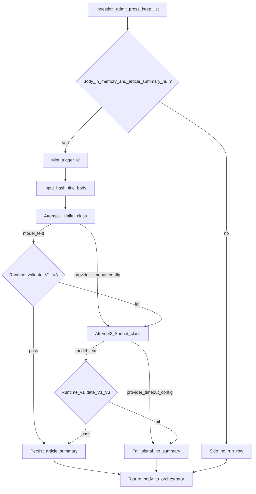

# Summarization — pipeline / runtime SoT

> **Stage:** Summarization · **Status:** Locked (B2) · **Last updated:** 2 Nov 2026 (MVP carry-over)  
> **Altitude:** Engineer pipeline SoT (pre-runtime). Does **not** duplicate prompt text — see [prompts/summarization.md](../prompts/summarization.md). Product meaning — [contracts/summarization.md](../../../02-product/contracts/summarization.md).

**Related**

- Product PRD: [model--summarization--v1.md](../../../02-product/prds/model--summarization--v1.md) (Spec locked B2)
- Product contract: [summarization.md](../../../02-product/contracts/summarization.md) (locked — SR-01…13)
- Prompt: [summarization.md](../prompts/summarization.md) (`summarization-v1` — Locked B2)
- Evals / gold: [evals/summarization.md](../evals/summarization.md) · [summarization.gold.json](../evals/summarization.gold.json) (Locked B2; arbiter 22/22)
- Runs: [summarization-runs.dbml](../data/summarization-runs.dbml) (Locked B2) · [dbdiagram](https://dbdiagram.io/d/6ae28ffced134e407e37a6d0)
- Ingestion orchestrator: [ingestion.md](./ingestion.md) (locked) — IR-05 body custody · IR-11 invoke
- Parallel same-tick: [story-tagging.md](./story-tagging.md) · metastory what-happened ([MR-08](../../../02-product/contracts/metastory.md))
- Ops pricing: [07-ops/model-pricing.json](../../../07-ops/model-pricing.json) · `#ops-pricing-models`
- Pattern: sibling [extraction.md](./extraction.md) · [story-tagging.md](./story-tagging.md)

---

## 1. Purpose

Orchestrate **when** summarization runs, **attempt / escalate** rules, **runtime validation**, **lineage**, **concurrency**, and **body borrow/return** — without owning prompt wording, gold cases, fetch drains, story chips, or metastory copy.

---

## 2. Happy path (sequence)

| Step | Rule |
|------|------|
| Trigger | Ingestion [IR-11](../../../02-product/contracts/ingestion.md): new press admit (clock or warm) with body **in memory** |
| Skip (no LLM, no run row) | X; no body; `article_summary` already present (incl. resurrect) |
| Input | That URI’s **title + body only** (never multi-URI stitch). Full vendor body MVP — **no truncate N** until cost evidence ([L3](#8-decision-log-b2)) |
| `trigger_id` | New UUID when entering the generate path; attempt 1 + 2 share it. **Stage-minted** — not inherited from ingestion or shared with story-tagging ([ingestion pipeline §5](./ingestion.md)) |
| Attempt 1 | Haiku-class primary (`summarization-v1` prompt) |
| Attempt 2 | Sonnet-class **only if** attempt 1 hits provider/timeout/config error **or** fails runtime validation. Max **2** LLM calls total |
| Success | Persist `press_articles.article_summary`; write succeeded run row(s); return body to orchestrator |
| Failure | No summary stored; failed run row(s) as applicable; return body; pool tick continues (fail open for URI) |
| Body discard | **Not this stage** — orchestrator discards after summarization + story-tagging + same-tick metastory what-happened (if any) finish ([IR-05](../../../02-product/contracts/ingestion.md)) |

Same-tick order vs story-tagging / metastory what-happened is **flexible** among consumers that need the body.

---

## 3. Post-model order (per attempt)

1. Receive model text (or error).
2. On provider / timeout / config error → mark attempt `failed` with `error_kind`; if attempts remain → escalate (L2); else final fail.
3. **Runtime validate** ([§4](#4-runtime-validation)): on fail → attempt `failed` (`schema_error` or `empty_response` as fits); escalate or final fail.
4. On pass → persist article summary (once per invoke success); attempt `succeeded`. **Trim only** — no hard char cap, no overlap-% rewrite, no claim-join overwrite of the model string (density / body-echo stay offline — [§4.2](#42-offline-only-not-runtime-gates)).
5. Always **return** body reference to orchestrator (borrow/return — do not discard here).

---

## 4. Runtime validation

**Fail the attempt** (escalate per §2 if attempts remain) when any of:

| ID | Condition |
|----|-----------|
| **V1** | Empty / whitespace-only after trim |
| **V2** | Not a single plain string usable as `article_summary` (e.g. JSON object/array envelope, or whole payload is a markdown heading block) |
| **V3** | So-what denylist hit (case-insensitive substring) — list below |
| **V4** | Provider / timeout / config error (escalate path; not text validation) |

### 4.1 So-what denylist (MVP)

| # | Pattern |
|---|--------|
| 1 | `this matters because` |
| 2 | `why this matters` |
| 3 | `what comes next` |
| 4 | `in conclusion` |
| 5 | `the bottom line` |
| 6 | `implications for` |
| 7 | `observers say this means` |

Expand from gold fails; prefer false negatives over broad tokens (`matters`, `impact`, …).

### 4.2 Offline only (not runtime gates)

Soft density (typically 2–4 sentences), long verbatim body-echo / overlap %, factual invention, translation quality → [evals/summarization.md](../evals/summarization.md) + human arbiter. No LLM judge in B2.

---

## 5. Lineage & hashing

| Field | Rule |
|-------|------|
| Grain | One `summarization_runs` row per LLM **attempt** |
| Skip / no-model | **No** row |
| `trigger_id` | Shared by ≤2 attempts for one invoke |
| `trigger_kind` | `clock` \| `warm` — closed enum in [summarization-runs.dbml](../data/summarization-runs.dbml) (Locked B2) |
| `input_hash` | SHA-256 hex of UTF-8 **`title + "\n\n" + body`** as sent to the model. Excludes system prompt (`prompt_version` covers instructions). No whitespace normalize |
| Body / summary in runs | **Never** store body. No `output_json` — product column is SoT |
| `estimated_cost_usd` | tokens × [model-pricing.json](../../../07-ops/model-pricing.json) at write; null if `model_id` missing from catalog |

---

## 6. Timeouts, concurrency, observability

| Knob | Default | Env (build) |
|------|---------|-------------|
| Per-attempt timeout | **15000** ms (ceiling; shared default with extraction + story-tagging) | `TEMPO_AI_SUMMARIZATION_TIMEOUT_MS` |
| Concurrent URI summarizations per tick | **4** (clamp 1–8) | `TEMPO_AI_SUMMARIZATION_CONCURRENCY` |

Per-URI attempts are **sequential** (Haiku then maybe Sonnet). Concurrency caps **how many URIs** may be in the summarization path at once.

**Logs / metrics (allowed):** `story_id`, `trigger_id`, `trigger_kind`, `prompt_version`, model id, status, `error_kind`, token counts, latency, concurrency pool stats.

**Never log (prod default):** publisher body, title+body payload, full article summary. Optional debug flag later — off by default.

**PostHog:** `summarization_invoke` once per finished **LLM** invoke (not per attempt; not on skip / no-body / summary-already-present) — [D-088](../../DECISIONS.md) / model PRD; wire at build.

---

## 7. Runtime gap (build phase)

**Target:** Invoked from ingestion on each eligible press admit; persist `article_summary`; lineage rows; orchestrator body discard after same-tick consumers.

**Today:** Stage **not shipped** at runtime. Prompt / pipeline / runs DBML / evals+gold are **Locked B2**; wire migrate + harness + `summarization_invoke` at build. Do **not** treat RSS / prototype cluster or meta-story “summary” writers / `verifyGrounding` claim-join as this SoT — only this LLM path writes `press_articles.article_summary`. Exact Haiku/Sonnet model ids: [prompts/summarization.md](../prompts/summarization.md).

---

## 8. Out of this document

- Prompt instructions / model ids → [prompts/summarization.md](../prompts/summarization.md)
- Product SR table → [contracts/summarization.md](../../../02-product/contracts/summarization.md)
- Gold / failure-mode craft → [evals/summarization.md](../evals/summarization.md)
- Source-reader chrome → [dashboard--v1.md](../../../02-product/prds/dashboard--v1.md) · [source-reader](../../../03-design/design-system/patterns/source-reader.md)
- Ingestion drains / admit / IR-05 barrier → [pipelines/ingestion.md](./ingestion.md)

---

## 9. Decision log (B2)

| Date | Lock | Choice |
|------|------|--------|
| 31 Oct 2026 | L1 | Extraction-shaped Locked pipeline SoT |
| 31 Oct 2026 | L2 | Attempt 1 Haiku-class; attempt 2 Sonnet-class on provider/timeout/validation fail; max 2 |
| 31 Oct 2026 | L3 | Full vendor body MVP; truncate N deferred until token/cost evidence |
| 31 Oct 2026 | L4 | Runtime = minimal + cheap code bars; density/echo offline |
| 31 Oct 2026 | L5 | Runtime fail IDs V1–V4 |
| 31 Oct 2026 | L6 | Denylist patterns 1–7 |
| 31 Oct 2026 | L7 | New UUID `trigger_id` per LLM invoke; skips → no rows |
| 31 Oct 2026 | L8 | Strict log minimize; borrow/return body; orchestrator discard |
| 31 Oct 2026 | L9 | 8s per-attempt timeout — **superseded** by Carry-over timeout → **15s** |
| 31 Oct 2026 | L10 | Concurrency default 4 (clamp 1–8) |
| 31 Oct 2026 | L11 | `input_hash` = SHA-256 of title + `\n\n` + body as sent |
| 31 Oct 2026 | L12 | Artifact written; Status Locked |
| 1 Nov 2026 | D1 | Runs DBML thickened Locked B2 — closed `trigger_kind` enum `clock` \| `warm`; `input_hash` note aligned to L11 |
| 2 Nov 2026 | Coherence pass | Related Locked labels; PostHog `summarization_invoke`; runtime gap = wire (not “prompt TBD”) |
| 2 Nov 2026 | Carry-over 1 | **A** — only this LLM path writes `article_summary`; no cluster/claim-join/meta-story summary as this stage |
| 2 Nov 2026 | Carry-over 2 | **A** — no hard length/overlap runtime gate; trim only; F7/long-body soft_length = advisory follow-up |
| 2 Nov 2026 | Carry-over 3 | **A** — keep locked 7-phrase so-what denylist (V3); expand only from gold fails |
| 2 Nov 2026 | Carry-over timeout | **15s** per attempt (was L9 8s); concurrency 4 unchanged |
