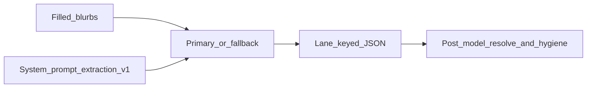

# Extraction — prompt / behavior SoT

> **Stage:** Extraction · **Prompt version:** `extraction-v1` · **Status:** Locked (Session B) · **Last updated:** 24 Oct 2026  
> **Altitude:** Engineer prompt SoT (pre-runtime). Implementation must mirror this file; do not treat live `extract-v8` as the target.

**Related**

- Product contract: [extraction.md](../../../02-product/contracts/extraction.md)
- Data (target): [tempo.dbml](../data/tempo.dbml) · [Database library](https://dbdiagram.io/d/6ab4852e58694256127b2a37)
- Extraction runs: [extraction-runs.dbml](../data/extraction-runs.dbml) · [dbdiagram](https://dbdiagram.io/d/Extraction-runs-6ab952050f25a52d011d406d)
- Legacy runtime (single-blob): [`onboarding-extractor.mjs`](../../apps/api/src/ai/onboarding-extractor.mjs) (`EXTRACT_PROMPT_VERSION = extract-v8`) — superseded by this SoT at build
- Pipeline / hygiene / resolve (Session C, locked): [pipelines/extraction.md](../pipelines/extraction.md)
- Pattern: stage prompt SoTs live at `06-engineering/docs/prompts/{stage}.md`

---

## 1. Invocation

| Rule | Detail |
|------|--------|
| Calls | **One** LLM call per “Build my scope” (or equivalent) with all **filled** blurbs |
| Empty blurbs | **Omit** from the user message; omit or empty that lane in JSON |
| Second pass | **Forbidden** — no enrichment LLM after this call |
| System vs user | **System** = shared rules + per-lane rules + JSON schema; **user** = labeled blurbs only |



---

## 2. Model policy

**Policy:** Extraction is a **rare, trust-critical** event. Prefer **quality over unit cost**.

| Role | Default SKU | Env override |
|------|-------------|--------------|
| Primary | `anthropic:claude-opus-5-5` | `TEMPO_AI_CLASSIFIER_MODEL` |
| Fallback | `anthropic:claude-sonnet-5-5` | `TEMPO_AI_CLASSIFIER_FALLBACK_MODEL` |

- Do **not** default to Fable-class models unless gold shows Opus 5.5 insufficient.
- SKU changes require a **DECISIONS** entry + eval evidence. Bump `extraction-vN` **only** when prompt instructions or output schema change — not for SKU-only swaps.
- Legacy defaults (`claude-opus-4-7` / `claude-sonnet-4-6`) remain in code until build adopts this SoT.

---

## 3. Version bump discipline

| Id | Meaning |
|----|---------|
| `extraction-v1` | This document — five-lane, one-call, lane-keyed JSON |

Bump to `extraction-v2` (etc.) when **any** of: system/user instruction text, JSON schema, or lane field semantics change. Record why in this doc’s decision log (and DECISIONS.md at build).

---

## 4. Wire format

### 4.1 User message

Only filled lanes, in order 1→5:

```text
## Lane 1 — Your role and organization
{blurb}

## Lane 2 — Your priorities
{blurb}

## Lane 3 — Your organization's priorities
{blurb}

## Lane 4 — Your stakeholders
{blurb}

## Lane 5 — Your sources
{blurb}
```

Omit any `## Lane N` block whose blurb is empty/skipped.

### 4.2 Target JSON schema (model output)

Return **ONLY** valid JSON — no markdown fences, no prose.

```json
{
  "identity": {
    "role_submitted": "string",
    "organization_submitted": "string",
    "function_label": "string"
  },
  "personalPriorities": {
    "topics": ["string"],
    "keywords": ["string"],
    "geographies": ["string"]
  },
  "organizationPriorities": {
    "topics": ["string"],
    "keywords": ["string"],
    "geographies": ["string"]
  },
  "stakeholders": {
    "mentions": ["string"]
  },
  "sources": {
    "traditionalSources": ["string"],
    "socialSources": ["string"]
  }
}
```

- If a lane was omitted from the user message, **omit** that top-level key **or** emit empty arrays / empty strings for its fields — prefer **omit** the key.
- Post-model (Session C): match `function_label` → `functions.name` → store `function_id`; treat `organization_submitted` as an alias candidate → `organizations`; never ask the model for UUIDs.

---

## 5. Shared rules (all lanes)

Distilled from legacy `extract-v8`; still binding.

1. **Conservative and minimal.** Fewest items that capture what the user **explicitly** states. When unsure, **omit**. Never pad.
2. **No fabrication.** Do not invent people, parties, titles, outlets, handles, or topics not present in the text.
3. **No speculative / secondary inference.** Do not add downstream themes the user did not center on.
4. **English:** `role_submitted`, `function_label`, topics, common-word keywords, geographies, and stakeholder classes. Examples: `jefa de comunicaciones` → `Head of Communications`; `migración` → `migration`; `Estados Unidos` → `United States`; `congreso` → `congress`.
5. **As written:** the blurbs themselves are not rewritten. Keep the user’s spelling for `organization_submitted`, traditional press names, social handles, and keyword proper names (person, organization, product) plus acronyms (`Cancillería`, `Petro`, `La Silla Vacía`, `@CancilleriaCol`).
6. **JSON only.** No markdown fences, no commentary.

---

## 6. Per-lane rules

### Lane 1 — Identity (`identity`)

| Field | Rule |
|-------|------|
| `role_submitted` | English title case for the role the user stated (`jefa de comunicaciones` → `Head of Communications`). Not the organization and not a UUID. |
| `organization_submitted` | Organization as stated (display). Downstream: alias → canonical `organizations` row. |
| `function_label` | Choose one name from the function list provided in this prompt, lowercase. That list is the current `functions.name` values. If none fits, omit `function_label`. Not a job title and not a UUID. |

Do not invent an employer or function the blurb does not support.

### Lanes 2–3 — Priorities (`personalPriorities` / `organizationPriorities`)

Same field rules; keep lanes **separate** (do not merge personal and org facets).

| Field | Rule |
|-------|------|
| `topics` | Collapsed theme only: what the operator follows, not the phrase they used. Short canonical labels (1–4 words). Usually **one or two** per blurb. Collapse related mentions into one label (`presidential elections` and `congressional elections` → `Elections`). Never a person, organization, product, instrument, or event. |
| `keywords` | Bare match term (1–2 words). A common word is English (`deportation flights` → `deportation`). A person, organization, product name, or acronym stays as written (`Petro`, `Cancillería`). Never a geography. Do not copy a name into stakeholders unless the stakeholders blurb states that class. |
| `geographies` | Country, region, or city the blurb names. Use the English name when one exists (`Nueva York` → `New York`). A city stays that city (`Bogotá` does not also emit `Colombia`). If the role blurb names a city and this priorities blurb says “local” without naming a different place, that city is a geography here (`consulate in Boston` plus `local papers` → `Boston`). “Local” with no city named anywhere adds nothing. Never duplicate a place into `keywords` or a topic label. |

### Lane 4 — Stakeholders (`stakeholders`)

| Field | Rule |
|-------|------|
| `mentions` | One short class for each party this blurb says the user must be ready for: who they act for, brief, answer to, coordinate with, or who can call them. Not a person's name. A named institution becomes the stable class (`Senate Foreign Relations Committee` → `congress`), not the full proper name. Emit every distinct class this blurb states. Collapse phrases in this blurb that name the same class. When unsure, omit. The example shows the shape of a class. It is not a list to choose from. Do not copy a name from another lane unless this blurb states that class. |

### Lane 5 — Sources (`sources`)

| Field | Rule |
|-------|------|
| `traditionalSources` | Official outlet names, including a leading article when it is part of the name (`The New York Times`, not `NYT` or `New York Times`). Colombian and Spanish outlets keep their proper names (`La Silla Vacía`, `Semana`, `Infobae`, `El Tiempo`). |
| `socialSources` | `@`-handles and clearly platform accounts. |

Classification: `@…` → social; named publications/wires → traditional; when uncertain → traditional.

---

## 7. System prompt body (`extraction-v1`)

Build-time assembly: concatenate §§5–6 into one system string, then append:

```text
You are an extraction assistant for Tempo onboarding scope.
Return ONLY valid JSON matching the schema in the prompt — no markdown fences, no prose.

[SHARED RULES — section 5]

[PER-LANE RULES — section 6]

Required JSON shape:
{ "identity": { "role_submitted", "organization_submitted", "function_label" },
  "personalPriorities": { "topics", "keywords", "geographies" },
  "organizationPriorities": { "topics", "keywords", "geographies" },
  "stakeholders": { "mentions" },
  "sources": { "traditionalSources", "socialSources" } }
Omit top-level keys for lanes not present in the user message.
Extract only what is explicitly stated.
```

(Exact concatenation order is fixed as: intro → shared → per-lane → schema reminder.)

At call time, append the current `functions.name` values after the per-lane rules, as the only allowed `function_label` names. Do not hardcode that list in this file.

---

## 8. Out of this document

- Deterministic hygiene (normalize, caps, geo/keyword strip, noise denylists, `KEYWORD_PATTERNS`) → Session C pipeline
- Alias / function catalog ops and UUID resolve → Session C + ops
- Eval / gold shape → Session E
- Code, env flips, migrations → build phase

---

## Decision log (Session B)

| Date | Lock | Choice |
|------|------|--------|
| 27 Sep 2026 | Path | `06-engineering/docs/prompts/extraction.md` |
| 27 Sep 2026 | Wire shape | System = rules; user = labeled blurbs |
| 27 Sep 2026 | JSON | Lane-keyed object |
| 27 Sep 2026 | Version id | `extraction-v1` |
| 27 Sep 2026 | Models | Quality-first; primary `claude-opus-5-5`; fallback `claude-sonnet-5` |
| 17 Oct 2026 | Models | Fallback → `claude-sonnet-5-5` (current Sonnet; closes D-072 revisit) |
| 27 Sep 2026 | Hygiene | Named as post-model; detailed in pipeline session |
| 27 Sep 2026 | Identity emit | `role_submitted`, `organization_submitted`, `function_label` (→ `functions.name` → `function_id`) |
| 21 Oct 2026 | Topic vs keyword | Topic = collapsed theme. Keyword = bare match term. Names are keywords, not topics. Same string in one lane is resolved in pipeline hygiene (keep topic). |
| 21 Oct 2026 | Stakeholder mentions | Every distinct class the blurb says the user must be ready for. Person names omitted. A named institution is stored as the stable class. The example is shape, not an allowlist. Version stays `extraction-v1` because this prompt has not shipped. |
| 23 Oct 2026 | Language | English for role, function, topics, common-word keywords, geographies, and stakeholder classes. As written: blurbs, organization, press, handles, and proper-name keywords. A named city does not also emit its country. Version stays `extraction-v1` because this prompt has not shipped. |
| 24 Oct 2026 | Press names | Official outlet name, including a leading article when it is part of that name (`The New York Times`). Casual abbreviations still expand to that official name. |
| 24 Oct 2026 | Local city | A city named in the role blurb is a geography on a priorities blurb that says “local” and names no other place. “Local” with no city named anywhere adds nothing. Do not also emit the containing region or country. |
