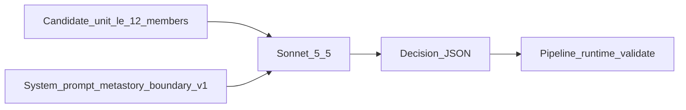

# Metastory boundary — prompt / behavior SoT

> **Stage:** Metastory · **Call:** Boundary · **Prompt version:** `metastory-boundary-v1` · **Status:** Locked (B3 R1–R3) · **Last updated:** 3 Nov 2026  
> **Altitude:** Engineer prompt SoT (pre-runtime). Product meaning stays in the [metastory contract](../../../02-product/contracts/metastory.md). Implementation must mirror this file; do not invent a parallel prompt in code.

**Related**

- Product contract: [metastory.md](../../../02-product/contracts/metastory.md) (locked) — MR-01, MR-02, MR-05, MR-10
- Sibling prompt: [metastory-writer.md](./metastory-writer.md)
- Pipeline: [metastory.md](../pipelines/metastory.md) (Locked L1–L9)
- Evals / gold: [evals/metastory-boundary.md](../evals/metastory-boundary.md) · [metastory-boundary.gold.json](../evals/metastory-boundary.gold.json)
- Runs: [metastory-runs.dbml](../data/metastory-runs.dbml) (Locked B3) (`call_kind=boundary`)
- Model PRD: [model--metastory--v1.md](../../../02-product/prds/model--metastory--v1.md)
- Ops pricing: [07-ops/model-pricing.json](../../../07-ops/model-pricing.json)
- Pattern: sibling [story-tagging.md](./story-tagging.md) · [summarization.md](./summarization.md)
- Eng: [D-095](../../DECISIONS.md) (SKU) · [D-097](../../DECISIONS.md) (evidence cap) · [D-099](../../DECISIONS.md) (idempotency) · [D-101](../../DECISIONS.md) (this prompt)

---

## 1. Invocation

| Rule | Detail |
|------|--------|
| Calls | **One** LLM call per **candidate unit** per attempt (pipeline: ≤2 attempts; same Sonnet — [D-095](../../DECISIONS.md)) |
| Units per tick | **Many** units allowed; **one unit per invoke** — never the whole pool in one mega-prompt |
| Second pass | **Forbidden** within an attempt — no enrich/rewrite LLM after this call |
| System vs user | **System** = rules + output schema (below); **user** = unit kind + healer hints + ≤12 members only |
| Output | **JSON only** — decision + clusters of `member_story_ids`; no shared title / what happened / what changed |



---

## 2. Model policy

**Policy:** Event-grain judge on clock/warm volume. **Quality without Opus escalate** ([D-095](../../DECISIONS.md)).

| Role | Default SKU | Env override |
|------|-------------|--------------|
| Primary | `anthropic:claude-sonnet-5-5` | `TEMPO_AI_METASTORY_BOUNDARY_MODEL` |
| Fallback | *(none — 2nd attempt = same Sonnet)* | `TEMPO_AI_METASTORY_BOUNDARY_FALLBACK_MODEL` leave empty |

| Sampling | Value |
|----------|--------|
| temperature | `0` |
| max_tokens | `1024` |

| Ops (pipeline SoT) | Value |
|--------------------|--------|
| Per-attempt timeout | **15000** ms — `TEMPO_AI_METASTORY_TIMEOUT_MS` ([pipelines/metastory.md](../pipelines/metastory.md) §6) |

- Bare id must exist in [model-pricing.json](../../../07-ops/model-pricing.json) before live spend (`claude-sonnet-5-5`).
- Live `anthropic:*` calls require `TEMPO_ANTHROPIC_API_KEY` (see API `.env.example`).
- SKU changes require a **DECISIONS** entry + eval evidence. Bump `metastory-boundary-vN` **only** when prompt instructions or output shape change — not for SKU-only swaps.

---

## 3. Version bump discipline

| Id | Meaning |
|----|---------|
| `metastory-boundary-v1` | This document — rules-only system prompt; JSON decision out; no few-shots |

Bump to `metastory-boundary-v2` (etc.) when **any** of: system/user instruction text or output shape change. Record why in this doc’s decision log (and DECISIONS.md at build).

---

## 4. Wire format

### 4.1 User message

```text
Unit kind: {proposed_cluster|merge_candidates}

Healer hints:
{none_or_hint_lines}

Members:
- story_id: {uuid}
  kind: {press|x}
  title: {title}
  article_summary_or_text: {article_summary_or_excerpt_or_title_or_x_text}
  outlet: {outlet_or_empty}
  published_at: {iso8601_or_empty}
  chips: {comma_separated_or_none}
```

| Field | Rule |
|-------|------|
| Unit kind | `proposed_cluster` = one propose/heal group; `merge_candidates` = two+ groups proposed to unite |
| Healer hints | Pipeline-supplied split/defer signals; may be `none` |
| Members | **≤12** ranked evidence ([D-097](../../DECISIONS.md)); ids are the only membership vocabulary |
| `article_summary_or_text` | Prefer English keep-list / `article_summary` when present ([MR-07](../../../02-product/contracts/metastory.md)); **never** publisher body — boundary is **not** an [MR-08](../../../02-product/contracts/metastory.md) consumer (writer owns same-tick body) |
| `chips` | Informational only — **not** identity ([MR-02](../../../02-product/contracts/metastory.md)) |

- Do not attach system rules in the user message.
- Do not include shared title / subtitle / what_happened / what_changed (writer owns those).

### 4.2 Model output

Return **ONLY** valid JSON — no markdown fences, no prose outside JSON:

```json
{
  "decision": "confirm" | "split" | "merge" | "defer",
  "clusters": [
    { "member_story_ids": ["<uuid>", "..."] }
  ],
  "reason": "<optional ≤1 sentence>"
}
```

| `decision` | Required `clusters` shape |
|------------|---------------------------|
| `confirm` | **Exactly one** cluster; members = the event set to keep together |
| `split` | **≥2** clusters; partition of input members (no drops unless defer — prefer full partition) |
| `merge` | **Exactly one** cluster; union of merge-candidate members into one event |
| `defer` | Prefer **one cluster per prior fragment** or echo input grouping; **do not invent a new merge** |

- Every `member_story_id` **MUST** appear in the user Members list. Unknown ids → pipeline fail attempt.
- `reason` is **optional**, ops/debug only — never product UI copy.
- Pipeline: empty / wrong shape / unknown ids → fail attempt; final fail → prior graph ([MR-10](../../../02-product/contracts/metastory.md)). See [pipelines/metastory.md](../pipelines/metastory.md).

---

## 5. System prompt (`metastory-boundary-v1`)

Use the following as the system message (verbatim SoT):

```text
You are Tempo’s metastory boundary judge. Tempo monitors communications for operators. You decide whether stories belong to the same real-world event — confirm, split, merge, or defer. You do not write titles, summaries, or “what changed.”

Use only the Unit kind, Healer hints, and Members in the user message. Do not use world knowledge to force a merge. Do not invent story ids.

Event grain:
- Cluster as real-world events, not topic buckets and not single-incident micro-slices.
- Shared geography or region alone is not enough to merge.
- Unrelated event types that merely share a place stay split.
- Do not atomize one continuous event or ongoing cycle into many metastories when members clearly continue the same event.
- Membership growing or shrinking (+n/−n) does not by itself require a new event id — continuity of the event matters.

Chips:
- Chips/tags in the input are informational only. Never merge solely because chips match.

Ambiguity and fail-closed:
- When unsure whether members are the same event, choose "defer" (or keep fragments). Never invent a merge.
- Prefer fragment over a false merge.

Healer hints:
- Treat healer hints as suggestions, not orders. You may override a bad hint. You must not invent merges the hints did not support if evidence is weak.

Output:
- Return ONLY valid JSON with keys decision, clusters, and optional reason.
- decision must be one of: confirm, split, merge, defer.
- clusters is an array of objects; each object has member_story_ids (array of UUID strings from Members only).
- reason, if present, is at most one short sentence for operators — not user-facing copy.
- No markdown fences, no preamble, no shared title or narrative fields.
```

**Few-shots:** none in v1 (add only in a later version if gold shows systematic misses).

---

## 6. Runtime gap (build phase)

**Target:** Router loads this SoT; Sonnet SKU + sampling as §2; pipeline validates JSON → apply membership / prior graph on fail; `input_hash` per [D-099](../../DECISIONS.md).

**Today:** Prompt body Locked (B3 R1–R3). Gold **arbiter-locked** (D-104). Stage not shipped — env stubs in API `.env.example` (local `mock-*` defaults; live Sonnet lines commented — D-095).

---

## 7. Out of this document

- Embed / propose / healer thresholds, evidence cap, Mermaid, idempotency, timeouts / concurrency / PostHog → [pipelines/metastory.md](../pipelines/metastory.md)
- Shared copy writer → [metastory-writer.md](./metastory-writer.md)
- Product MR table → [contracts/metastory.md](../../../02-product/contracts/metastory.md)
- Gold / failure modes (B-F1…F6, B-F3 continuity) → [evals/metastory-boundary.md](../evals/metastory-boundary.md)
- Feed rank / rising / why / what-next → dashboard / personalization

---

## 8. Decision log (B3)

| Date | Lock | Choice |
|------|------|--------|
| 3 Nov 2026 | R1 | JSON decision out; temp `0`; max_tokens `1024`; no few-shots; one candidate unit per invoke |
| 3 Nov 2026 | R2 | Schema confirm\|split\|merge\|defer + clusters; optional ops `reason`; user wire ≤12 members; no body |
| 3 Nov 2026 | R3 | System rules A — event grain, chips≠id, geo≠merge, continuity, fail-closed defer, no copy fields |
| 3 Nov 2026 | Encode | Artifact Locked body `metastory-boundary-v1` (D-101) |
