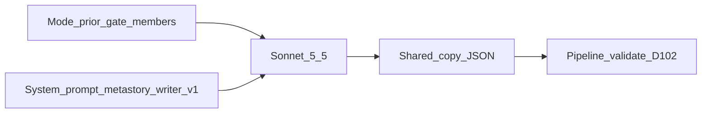

# Metastory writer — prompt / behavior SoT

> **Stage:** Metastory · **Call:** Writer · **Prompt version:** `metastory-writer-v1` · **Status:** Locked (B3 W1–W3 · d05 soft length folded 5 Nov 2026) · **Last updated:** 5 Nov 2026  
> **Altitude:** Engineer prompt SoT (pre-runtime). Product meaning stays in the [metastory contract](../../../02-product/contracts/metastory.md). Implementation must mirror this file; do not invent a parallel prompt in code.

**Related**

- Product contract: [metastory.md](../../../02-product/contracts/metastory.md) (locked) — MR-06…MR-10 · [D-102](../../DECISIONS.md)
- Sibling prompt: [metastory-boundary.md](./metastory-boundary.md) (Locked D-101)
- Pipeline: [metastory.md](../pipelines/metastory.md) (Locked L1–L9)
- Evals / gold: [evals/metastory-writer.md](../evals/metastory-writer.md) · [metastory-writer.gold.json](../evals/metastory-writer.gold.json)
- Runs: [metastory-runs.dbml](../data/metastory-runs.dbml) (Locked B3) (`call_kind=writer`)
- Model PRD: [model--metastory--v1.md](../../../02-product/prds/model--metastory--v1.md)
- Ops pricing: [07-ops/model-pricing.json](../../../07-ops/model-pricing.json)
- Pattern: sibling [summarization.md](./summarization.md) · [metastory-boundary.md](./metastory-boundary.md)
- Eng: [D-095](../../DECISIONS.md) (SKU) · [D-097](../../DECISIONS.md) (evidence) · [D-099](../../DECISIONS.md) / [D-107](../../DECISIONS.md) (idempotency + same-tick body) · [D-102](../../DECISIONS.md) (requiredness) · [D-103](../../DECISIONS.md) (this prompt)

---

## 1. Invocation

| Rule | Detail |
|------|--------|
| Calls | **One** LLM call per metastory per attempt (pipeline: ≤2; same Sonnet — [D-095](../../DECISIONS.md)) |
| When | After material gate says **material** or **first mint** needs title; **skip** if gate none + last-good, or writer `input_hash` unchanged ([D-099](../../DECISIONS.md)) |
| Second pass | **Forbidden** within an attempt |
| System vs user | **System** = rules + schema; **user** = Mode + prior copy + gate + ≤12 members |
| Output | **JSON only** — `title`, `subtitle`, `what_happened`, `what_changed` |



---

## 2. Model policy

**Policy:** Shared English card copy — product surface. Sonnet-only, no Opus escalate ([D-095](../../DECISIONS.md)).

| Role | Default SKU | Env override |
|------|-------------|--------------|
| Primary | `anthropic:claude-sonnet-5-5` | `TEMPO_AI_METASTORY_WRITER_MODEL` |
| Fallback | *(none — 2nd attempt = same Sonnet)* | `TEMPO_AI_METASTORY_WRITER_FALLBACK_MODEL` leave empty |

| Sampling | Value |
|----------|--------|
| temperature | `0` |
| max_tokens | `1024` |

| Ops (pipeline SoT) | Value |
|--------------------|--------|
| Per-attempt timeout | **15000** ms — `TEMPO_AI_METASTORY_TIMEOUT_MS` ([pipelines/metastory.md](../pipelines/metastory.md) §6) |

- Bare id in [model-pricing.json](../../../07-ops/model-pricing.json) (`claude-sonnet-5-5`).
- Live calls need `TEMPO_ANTHROPIC_API_KEY`.
- Bump `metastory-writer-vN` only when instructions or output shape change — not SKU-only swaps.

---

## 3. Version bump discipline

| Id | Meaning |
|----|---------|
| `metastory-writer-v1` | Rules-only system prompt; four-field JSON; no few-shots |

---

## 4. Wire format

### 4.1 User message

```text
Mode: {first_mint|update}
Material gate: {material|first_mint}

Prior shared copy:
{none|{title,subtitle,what_happened,what_changed}}

Members:
- story_id: {uuid}
  kind: {press|x}
  title: {title}
  article_summary_or_text: {summary_or_excerpt_or_title_or_x_text}
  same_tick_body: {empty_or_publisher_body_this_tick_only}
  outlet: {outlet_or_empty}
  published_at: {iso8601_or_empty}
```

| Field | Rule |
|-------|------|
| `Mode` | Pipeline SoT for first mint vs update — model must not infer |
| `Material gate` | Writer is only invoked when material or first mint; never invent a delta when gate would have been `none` |
| Prior copy | `none` on first mint; else last-good shared fields |
| Members | ≤12 ([D-097](../../DECISIONS.md)); prefer English keep-list / `article_summary` |
| `same_tick_body` | **Optional.** Non-empty **only** for **new** press members whose publisher body is still in memory this tick ([MR-08](../../../02-product/contracts/metastory.md) / [IR-05](../../../02-product/contracts/ingestion.md)). Empty for X, for press without body, and after orchestrator discard. Never persist/log. Boundary does **not** receive this field |

- No why / what-next / chips-as-identity / feed rank in this message.

### 4.2 Model output

Return **ONLY** valid JSON:

```json
{
  "title": "...",
  "subtitle": "...",
  "what_happened": "...",
  "what_changed": "..." 
}
```

| Key | Success rule ([D-102](../../DECISIONS.md)) |
|-----|-----------------------------------------------|
| `title` | Non-empty string |
| `subtitle` | Non-empty string |
| `what_happened` | Non-empty string |
| `what_changed` | JSON **`null`** when `Mode: first_mint`; non-empty string when `Mode: update` |

- English (MR-07). No markdown fences, no preamble.
- Pipeline: empty required fields / wrong shape / update with null `what_changed` → **fail attempt**; final fail → last-good or no mint ([MR-10](../../../02-product/contracts/metastory.md)).

### Soft length (d05 — live)

Open-card soft targets (advisory; why-primary hierarchy). Soft length is **not** a hard runtime trim. **Do not treat archived why-doctrine (summary longest) as live SoT.** Title / subtitle: no soft bars.

| Field | Soft sentences | Soft chars |
|-------|----------------|------------|
| `what_happened` | 1–2 | ~250–350 |
| `what_changed` (update only) | 1–2 | ~200–300 |

Prefer evidence density over padding. Do not invent facts or drama to hit length. Thin evidence / thin material delta → stay thin (eval carve-outs). Personalization why (~350–450) stays the longer open-card band.

Eval / gold: [evals/metastory-writer.md](../evals/metastory-writer.md).

---

## 5. System prompt (`metastory-writer-v1`)

Use the following as the system message (verbatim SoT). Soft length folded pre-runtime — **keep** prompt id `metastory-writer-v1` (no bump until first post-runtime instruction change).

```text
You write Tempo’s shared metastory card copy for communications operators. You produce one English title, subtitle, what happened, and what changed for a single real-world event. You do not decide cluster membership (boundary already did). You do not write why this matters or what comes next.

Use only Mode, Material gate, Prior shared copy, and Members in the user message. Ground every factual claim in that evidence. Do not add world knowledge, speculation, or outlets not supported by Members. When a Member includes same_tick_body, use it to ground what_happened; prefer article_summary_or_text when both are present; do not paste long publisher body verbatim into shared fields.

Field meanings:
- title: Short event headline. Prefer the prior title text when Mode is update unless a rename is clearly warranted by new evidence.
- subtitle: One supporting line that clarifies the event — required, never empty on success.
- what_happened: Factual narrative of the event (who/what/where/when as evidence supports). Not so-what, implications, or advice. Soft target: 1–2 sentences / ~250–350 characters. Prefer evidence density over padding; do not invent to hit length.
- what_changed: Material movement versus the prior shared run of this metastory only — not “since you last looked.” When Mode is first_mint, set what_changed to null. When Mode is update, write a non-empty what_changed grounded in what actually moved. Soft target: 1–2 sentences / ~200–300 characters. Thin material → stay thin; do not invent drama to hit length.

Requiredness:
- On success, title, subtitle, and what_happened must be non-empty.
- what_changed must be null on first_mint and a non-empty string on update.

Forbidden:
- Why this matters, what comes next, prescriptions, or opinion framing.
- Invented deltas when evidence shows nothing material.
- User-relative language (“since your last refresh,” “new to you”).
- Markdown fences, preamble, or keys other than title, subtitle, what_happened, what_changed.
- Publisher body text that is not in Members (including inventing body content beyond same_tick_body).
- Dumping long same_tick_body verbatim into title, subtitle, what_happened, or what_changed.

Output:
- Return ONLY valid JSON with keys title, subtitle, what_happened, and what_changed.
```

**Few-shots:** none in v1.

---

## 6. Runtime gap (build phase)

**Target:** Router loads this SoT; validate D-102; persist four fields; `input_hash` per D-099.

**Today:** Prompt body Locked (B3 W1–W3 + d05 soft length in system rules; id stays `metastory-writer-v1`). Gold **arbiter-locked** (D-105) with d05 evidence-earned thicken + carve-outs (5 Nov 2026). Env stubs in API `.env.example` (local `mock-*` defaults; live Sonnet lines commented — D-095).

---

## 7. Out of this document

- Boundary / membership → [metastory-boundary.md](./metastory-boundary.md)
- Material gate / evidence cap / skips / timeouts / concurrency / PostHog → [pipelines/metastory.md](../pipelines/metastory.md)
- Gold / W-F1… → [evals/metastory-writer.md](../evals/metastory-writer.md)
- Feed ≤5 / complete-card chrome → [dashboard--v1.md](../../../02-product/prds/dashboard--v1.md) (D-102 parked)
- Why / what-next → personalization

---

## 8. Decision log (B3)

| Date | Lock | Choice |
|------|------|--------|
| 3 Nov 2026 | W1 | JSON four fields; temp 0; max_tokens 1024; no few-shots; one metastory per invoke |
| 3 Nov 2026 | W2 | Schema + Mode/prior/gate/members wire; what_changed null via Mode first_mint |
| 3 Nov 2026 | W3 | System rules A (grounding, D-102, shared-run delta, title-prefer, no so-what) |
| 3 Nov 2026 | Encode | Artifact Locked `metastory-writer-v1` (D-103) |
| 3 Nov 2026 | Coherence | Optional `same_tick_body` on Members per [MR-08](../../../02-product/contracts/metastory.md) / [IR-05](../../../02-product/contracts/ingestion.md); boundary stays body-free; no promptVersion bump (pre-runtime amend) |
| 5 Nov 2026 | d05 length stub | Soft happened/changed targets parked § soft length (pre-fold) |
| 5 Nov 2026 | d05 length fold | Soft bars into §5 system rules; keep `metastory-writer-v1` (pre-runtime, no bump) |
| 5 Nov 2026 | d05 gold thicken | Evidence-earned B′ + carve-outs; soft advisory; no promptVersion bump — **closed** before B5 |
