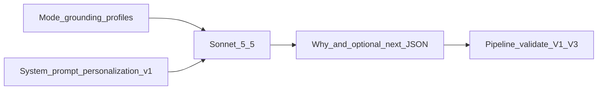

# Personalization — prompt / behavior SoT

> **Stage:** Personalization · **Prompt version:** `personalization-v1` · **Status:** Locked (B4 Pr1–Pr6) · **Last updated:** 5 Nov 2026  
> **Altitude:** Engineer prompt SoT (pre-runtime). Product meaning stays in the [personalization contract](../../../02-product/contracts/personalization.md). Implementation must mirror this file; do not invent a parallel prompt in code. Gold arbiter-locked (24 cases; advisory until promote).

**Related**

- Product contract: [personalization.md](../../../02-product/contracts/personalization.md) (locked — PR-01…14)
- Model PRD: [model--personalization--v1.md](../../../02-product/prds/model--personalization--v1.md) (B4 design Locked · build deferred)
- Pipeline: [personalization.md](../pipelines/personalization.md) (B4 design Locked · D-108 · PR-14)
- Practice notes: [practice-notes/](../../../02-product/practice-notes/README.md) · seed [practice-notes.seed.json](../data/practice-notes.seed.json) v2 · handoff [practice-notes-seed.md](../data/practice-notes-seed.md)
- Evals / gold: [personalization.md](../evals/personalization.md) · [personalization.gold.json](../evals/personalization.gold.json) (24 cases; arbiter-locked 5 Nov 2026; advisory until promote)
- Runs: [personalization-runs.dbml](../data/personalization-runs.dbml) (D-109 · D-110) · [dbdiagram](https://dbdiagram.io/d/6ae28fcfaac33014104ead45)
- ERD: [tempo.dbml](../data/tempo.dbml) `practice_notes` · [Database library](https://dbdiagram.io/d/6ab4852e58694256127b2a37)
- Dashboard chrome (what-next null): [dashboard--v1.md](../../../02-product/prds/dashboard--v1.md)
- Ops pricing: [07-ops/model-pricing.json](../../../07-ops/model-pricing.json)
- Pattern: sibling [summarization.md](./summarization.md) · [metastory-writer.md](./metastory-writer.md)

---

## 1. Invocation

| Rule | Detail |
|------|--------|
| Calls | **One** LLM call per membership per attempt (pipeline: ≤2; same Sonnet) |
| When | After join; cache miss; clock \| warm — **no UX** |
| Mode | **`both-fields`** when function resolved **and** practice-note body present; else **`why-only`** ([PR-14](../../../02-product/contracts/personalization.md)) |
| Second pass | **Forbidden** within an attempt |
| System vs user | **System** = rules only (no few-shots); **user** = mode + grounding + profiles (+ practice note id/version/body when both-fields) |
| Output | **JSON only** — see §4.2 |



---

## 2. Model policy (Pr1 locked)

**Policy:** Per-user readiness copy — product surface. Sonnet-only, no Haiku escalate (X3).

| Role | Default SKU | Env override |
|------|-------------|--------------|
| Primary | `anthropic:claude-sonnet-5-5` | `TEMPO_AI_PERSONALIZATION_MODEL` |
| Fallback | *(none — 2nd attempt = same Sonnet)* | `TEMPO_AI_PERSONALIZATION_FALLBACK_MODEL` leave empty |

| Sampling | Value |
|----------|--------|
| temperature | `0` |
| max_tokens | `512` |

| Ops (pipeline SoT) | Value |
|--------------------|--------|
| Per-attempt timeout | **15000** ms — `TEMPO_AI_PERSONALIZATION_TIMEOUT_MS` |

- Bare id in [model-pricing.json](../../../07-ops/model-pricing.json) (`claude-sonnet-5-5`).
- Live calls need `TEMPO_ANTHROPIC_API_KEY`.
- Bump `personalization-vN` only when instructions or output shape change — not SKU-only swaps.

---

## 3. Version bump discipline

| Id | Meaning |
|----|---------|
| `personalization-v1` | Rules-only system prompt; why + optional what-next JSON; mode why-only \| both-fields; no em dashes (U+2014) in model output (folded pre-prod) |

---

## 4. Wire format (Pr2 locked)

### 4.1 User message

Order matches pipeline [`input_hash` §5.1](../pipelines/personalization.md). Practice-note **body** is sent to the model; hash uses **id + version** only.

```text
Mode: {why-only|both-fields}

Grounding:
title: {title}
subtitle: {subtitle}
what_happened: {what_happened}
what_changed: {what_changed_or_empty}

Org priorities:
{org_priorities_blurb_or_empty}

Personal priorities:
{personal_priorities_blurb_or_empty}

Function:
{function_label_or_id_or_empty}

Stakeholders:
{stakeholders_payload_or_empty}

Practice note:
id: {practice_note_id_or_empty}
version: {practice_note_version_or_empty}
text:
{practice_note_body_or_empty}
```

| Field | Rule |
|-------|------|
| `Mode` | Pipeline SoT — model must not infer. `why-only` when function empty/unresolved or practice-note body missing |
| Grounding | Shared metastory fields only; empty `what_changed` OK (first mint) |
| Why path | Uses grounding + org + personal priorities only — **ignore** function, stakeholders, practice note for why |
| What-next path | Only when `Mode: both-fields`; uses all blocks; practice note **required** |
| Empty function | Allowed; implies why-only (pipeline should already set Mode) |
| No | Raw publisher body; feed rank; account CTA strings |

### 4.2 Model output

**`Mode: both-fields`** — return **ONLY** valid JSON:

```json
{
  "why_this_matters": "...",
  "what_comes_next": "..."
}
```

**`Mode: why-only`** — return **ONLY** valid JSON:

```json
{
  "why_this_matters": "..."
}
```

| Key | Success rule |
|-----|--------------|
| `why_this_matters` | Always required; non-empty string |
| `what_comes_next` | Required non-empty when `both-fields`; **omit** (or pipeline ignores) when `why-only` |

- English (PR-10). No markdown fences, no preamble.
- Pipeline: empty required fields / wrong shape / prescribe denylist → **fail attempt**; final fail → last-good or hide ([PR-11](../../../02-product/contracts/personalization.md) · [PR-12](../../../02-product/contracts/personalization.md)).

---

## 5. System rules (Pr3 + Pr4 + Pr5 Locked)

Paste as the **system** message (rules-only; **no few-shots** — Pr4). Soft length is advisory (eval/offline); not a hard runtime trim.

```text
You write Tempo personalization copy for a solo institutional operator.

MODE
- Obey Mode in the user message exactly.
- why-only: produce why_this_matters only. Do not invent function, practice note, or what_comes_next. Ignore Practice note text if present.
- both-fields: produce why_this_matters and what_comes_next. Obey the Practice note text in the user message (posture / prefer / avoid / case families). Do not invent a different note.

WHY THIS MATTERS (always)
- Share-safe org/situation voice. Suitable to paste with shared story fields to contacts.
- Personal priorities may weight emphasis only; no second-person address to personal priorities ("you care about…").
- Do NOT use function lens, practice-note framing, or name stakeholders.
- Do NOT retell title, subtitle, what_happened, or what_changed.
- Do NOT prescribe send, publish, post, issue, respond-now, or decide.
- Soft target: 2–3 sentences / ~350–450 characters (d05 primary band). Prefer evidence over framing.

WHAT COMES NEXT (both-fields only)
- Private readiness framing for this user; prepares a possible step; non-directive.
- Obey the Practice note text (posture / prefer / avoid / case families). Pick the best-fit family; state one primary readiness hint.
- May use function, priorities, stakeholders, and grounding; still do NOT retell grounding as the body.
- Do NOT prescribe send, publish, post, issue, respond-now, or decide (pp5).
- Soft target: 1–2 sentences / ~250–350 characters (peer to why; must not out-length primary).

FORBIDDEN (either field)
- Stakeholders named in why.
- Function or practice-note framing in why.
- Retelling what happened / what changed.
- Directives to send / publish / decide / respond now / issue a statement.
- Inventing profile facts, clearance chains, deadlines, or stakeholders not in inputs.
- Account UI instructions ("go to settings", "define your role"); chrome is out of model scope.
- Explaining id/version/cache semantics; pipeline owns those.
- Em dashes (Unicode U+2014). Use commas, colons, or periods instead. Same house style as practice-note bodies.
- Markdown fences, preamble, or keys other than those required for Mode.

OUTPUT
- JSON only. Keys per Mode. English. No trailing commentary.
```

---

## 6. Practice notes

- Four functions: communications, policy, operations, partnerships.
- Catalog: [tempo.dbml](../data/tempo.dbml) `practice_notes` (id, function_id, version, body, source_refs).
- Bodies: seed each function’s **Model body** from [practice-notes/](../../../02-product/practice-notes/README.md) (all four Locked F-pass; non-comms 🟠 provisional) · [practice-notes.seed.json](../data/practice-notes.seed.json).
- Injection: **user message** carries id + version + body (Pr5). System only states obedience / why-only restraint — no versioning lecture.
- Missing body or empty function → pipeline sets `Mode: why-only` (PR-14).

---

## 7. Runtime gap / next

**Target:** Router loads this SoT; validate V1–V3; persist why (+ what-next); seed notes at build per [practice-notes-seed.md](../data/practice-notes-seed.md).

**Today:** Prompt **Locked** (Pr1–Pr6). Gold arbiter-locked (24; advisory until promote). Runs `trigger_kind` closed `clock` \| `warm` ([D-109](../../DECISIONS.md)). B4 design Locked · build deferred ([D-110](../../DECISIONS.md)). Env stubs in API `.env.example` (local `mock-*` defaults; live Sonnet lines commented — X3).

**Revisit → `personalization-v2`:** instruction or output-shape change from gold/production fails (not SKU-only).

---

## 8. Decision log

| Date | Lock | Choice |
|------|------|--------|
| 5 Nov 2026 | Pr1 | `personalization-v1`; JSON two fields (why-only omits next); Sonnet-only; temp 0; max_tokens 512 |
| 5 Nov 2026 | Pr2 | User message order = input_hash; practice note body in message; Mode why-only \| both-fields |
| 5 Nov 2026 | Pr3 | System rules §5 (why-only / gated what-next / forbidden / soft length) |
| 5 Nov 2026 | Pr4 | Soft length only; **no few-shots**; no hard runtime trim |
| 5 Nov 2026 | Pr5 | Note injection in user message; system = obey / ignore-for-why / no invent on why-only; no versioning lecture |
| 5 Nov 2026 | Pr6 | Artifact **Locked** `personalization-v1`; gold advisory until promote |
| 5 Nov 2026 | Ev encode | Suite map + gold drafted |
| 5 Nov 2026 | Style | No em dashes (U+2014) in system rules / gold expected / practice-note bodies; seed **v2**; keep prompt id `personalization-v1` (pre-prod, no version bump) |
| 5 Nov 2026 | Gold | 24 cases arbiter-locked; advisory until promote; no LLM judge |
| 5 Nov 2026 | Status | B4 design Locked — build deferred ([D-110](../../DECISIONS.md)) |
