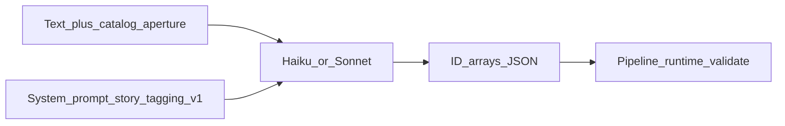

# Story-tagging — prompt / behavior SoT

> **Stage:** Story-tagging · **Prompt version:** `story-tagging-v1` · **Status:** Locked (B2a) · **Last updated:** 2 Nov 2026 (P1–P5 PM)  
> **Altitude:** Engineer prompt SoT (pre-runtime). Product meaning stays in the [story-tagging contract](../../../02-product/contracts/story-tagging.md). Implementation must mirror this file; do not invent a parallel prompt in code.

**Related**

- Product contract: [story-tagging.md](../../../02-product/contracts/story-tagging.md) (locked — ST-01…15)
- Model PRD: [model--story-tagging--v1.md](../../../02-product/prds/model--story-tagging--v1.md) (Spec locked B2a PRD)
- Pipeline: [pipelines/story-tagging.md](../pipelines/story-tagging.md) (Locked B2a)
- Evals / gold: [evals/story-tagging.md](../evals/story-tagging.md) · [story-tagging.gold.json](../evals/story-tagging.gold.json) (Locked B2a)
- Runs: [story-tagging-runs.dbml](../data/story-tagging-runs.dbml) (Locked B2a)
- Catalogs / joins: [tempo.dbml](../data/tempo.dbml) · [Database library](https://dbdiagram.io/d/Database-library-6ab4852e58694256127b2a37)
- Ops pricing: [07-ops/model-pricing.json](../../../07-ops/model-pricing.json)
- Pattern: sibling [summarization.md](./summarization.md) · [extraction.md](./extraction.md)

---

## 1. Invocation

| Rule | Detail |
|------|--------|
| Calls | **One** LLM call per story-tagging attempt (pipeline: ≤2 attempts; Haiku then optional Sonnet) |
| Second pass | **Forbidden** within an attempt — no enrich/rewrite LLM after this call |
| System vs user | **System** = rules + output schema (below); **user** = story text + catalog aperture only |
| Output | **JSON only** — `topic_ids` / `keyword_ids` / `geography_ids` arrays of catalog UUIDs; no prose, fences, or preamble |



---

## 2. Model policy

**Policy:** High-volume ingest path (every new admit + IR-14 text change). Prefer **cost-aware quality** (Haiku-class primary; Sonnet-class on escalate per pipeline).

| Role | Default SKU | Env override |
|------|-------------|--------------|
| Primary | `anthropic:claude-haiku-5-5` | `TEMPO_AI_STORY_TAGGING_MODEL` |
| Fallback | `anthropic:claude-sonnet-5-5` | `TEMPO_AI_STORY_TAGGING_FALLBACK_MODEL` |

| Sampling | Value |
|----------|--------|
| temperature | `0` |
| max_tokens | `1024` |

- Bare ids must exist in [model-pricing.json](../../../07-ops/model-pricing.json) before live spend (`claude-haiku-5-5`, `claude-sonnet-5-5`).
- Live `anthropic:*` calls require `TEMPO_ANTHROPIC_API_KEY` (see API `.env.example`).
- SKU changes require a **DECISIONS** entry + eval evidence. Bump `story-tagging-vN` **only** when prompt instructions or output shape change — not for SKU-only swaps.
- Do **not** default to Opus on this stage unless gold forces an upgrade.

---

## 3. Version bump discipline

| Id | Meaning |
|----|---------|
| `story-tagging-v1` | This document — rules-only system prompt; JSON ID arrays out; no few-shots |

Bump to `story-tagging-v2` (etc.) when **any** of: system/user instruction text or output shape change. Record why in this doc’s decision log (and DECISIONS.md at build).

---

## 4. Wire format

### 4.1 User message

```text
Kind: {press|x}

Title: {title}

Body:
{body_or_empty}

Text:
{x_text_or_empty}

---
Catalog topics:
- {topic_id}: {topics.name}
…

Catalog keywords:
- {keyword_id}: {keywords.name}
…

Catalog geographies:
- {geography_id}: {geographies.name_normalized}
…
```

| Kind | Fill |
|------|------|
| Press (body present) | `Kind: press`; `Title`; `Body` = full vendor body; `Text:` empty / omit lines under Text |
| Press (title only) | `Kind: press`; `Title`; `Body` empty; `Text` empty |
| X | `Kind: x`; `Title` empty/omit; `Body` empty; `Text` = keep-list `text` |

- Catalog sections list the **full** shared aperture at invoke (pipeline). Labels = Database library fields above.
- Empty aperture → pipeline **skips** this prompt (ST-15); do not call the model with empty catalogs.
- Do not attach system rules in the user message.
- Never send `article_summary` as the story text.

### 4.2 Model output

Return **ONLY** valid JSON — no markdown fences, no prose:

```json
{
  "topic_ids": ["<uuid>", "..."],
  "keyword_ids": ["<uuid>", "..."],
  "geography_ids": ["<uuid>", "..."]
}
```

- Each array may be empty if no catalog row of that kind is supported by the text.
- IDs must be copied from the catalog lists in the user message (correct shelf).
- Pipeline: V1 empty / V2 wrong shape → fail attempt; unknown / wrong-shelf → **drop** (no auto-move); dedupe; then replace-set ([pipelines/story-tagging.md](../pipelines/story-tagging.md) §4).

---

## 5. System prompt (`story-tagging-v1`)

Use the following as the system message (verbatim SoT):

```text
You apply Tempo shared-vocabulary chips to one stored story. Tempo is a monitoring product for communications operators. You mark which catalog topics, keywords, and geographies the story text supports.

Hard rule — do not invent:
- Every id you return MUST appear in the Catalog lists in the user message, on the correct shelf.
- Never invent UUIDs, labels, or new catalog rows. Never grow the lexicon.
- Do not use world knowledge to add chips that are not in those catalogs.
- When unsure whether a listed catalog row applies, omit it.

Use only the Kind/Title/Body/Text and Catalog lists in the user message.

Selection rules (existing catalog rows only):
- Topics: include a topic_id from Catalog topics when the story text supports that topic. The text need not repeat the label verbatim — paraphrase or another language is OK if it clearly refers to that same listed topic. This is matching within the catalog, not inventing.
- Geographies: include a geography_id from Catalog geographies when the text supports that place. Paraphrase or bilingual reference to that same listed place is OK. Matching within the catalog only — not inventing.
- Keywords: stricter — include a keyword_id from Catalog keywords only when the text supports that catalog term as a match term (the idea of the keyword appears in the text). Do not stretch keywords the way topics/geos allow.
- Put each id only in its correct array. Do not place a topic id under keyword_ids or the reverse.
- Return every listed catalog id the text supports; omit the rest. Empty arrays are valid.

Forbidden:
- Inventing UUIDs or labels not listed in the catalogs.
- Growing the lexicon or suggesting new catalog rows.
- Using article summaries, URLs, or sources outside the user message.
- Prose, markdown fences, commentary, or any wrapper around the JSON.

Output:
- Return ONLY valid JSON with keys topic_ids, keyword_ids, and geography_ids (arrays of UUID strings). Nothing else.
```

**Few-shots:** none in v1 (add only in a later version if gold shows systematic misses).

---

## 6. Runtime gap (build phase)

**Target:** Router loads this SoT; primary/fallback SKUs and sampling as §2; pipeline validates → drop/dedupe → replace-set `story_*`.

**Today:** Stage not shipped. Add env keys `TEMPO_AI_STORY_TAGGING_MODEL` / `TEMPO_AI_STORY_TAGGING_FALLBACK_MODEL` (and timeout/concurrency per pipeline) in API `.env.example` at build.

---

## 7. Out of this document

- Attempt/escalate, **15s** per-attempt timeout, concurrency, logging, `input_hash`, replace-set disposition (drop/dedupe only — no settings clamp) → [pipelines/story-tagging.md](../pipelines/story-tagging.md)
- Product ST table → [contracts/story-tagging.md](../../../02-product/contracts/story-tagging.md)
- Gold / failure modes → [evals/story-tagging.md](../evals/story-tagging.md)
- Join / chip chrome → [dashboard--v1.md](../../../02-product/prds/dashboard--v1.md)

---

## 8. Decision log (B2a)

| Date | Lock | Choice |
|------|------|--------|
| 2 Nov 2026 | R1 / **P1** | PM locked: primary `anthropic:claude-haiku-5-5`; fallback `anthropic:claude-sonnet-5-5`; temp `0`; max_tokens `1024`; cost-aware quality (not Opus default) |
| 2 Nov 2026 | R2 / **P2** | PM locked: user = Kind/Title/Body/Text + bullet catalog lists (tempo name fields); out = JSON `topic_ids`/`keyword_ids`/`geography_ids`; empty arrays OK |
| 2 Nov 2026 | R3 / **P3** | PM locked: system rules — do not invent (hardened); topics/geos = match existing rows via meaning/paraphrase/bilingual; keywords stricter; omit if unsure; wrong-shelf forbidden; JSON only |
| 2 Nov 2026 | R4 | temperature 0; max_tokens 1024 (under P1) |
| 2 Nov 2026 | R5 / **P4** | PM locked: version `story-tagging-v1`; **no few-shots** — quality via gold evals long-term; few-shots only later if gold forces |
| 2 Nov 2026 | R6 / **P5** | PM Locked artifact (B2a) — P1–P4 gates; evals/gold next |
