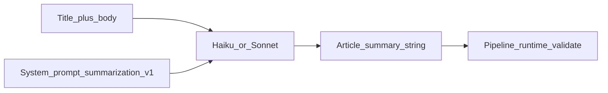

# Summarization — prompt / behavior SoT

> **Stage:** Summarization · **Prompt version:** `summarization-v1` · **Status:** Locked (B2) · **Last updated:** 2 Nov 2026 (coherence pass)  
> **Altitude:** Engineer prompt SoT (pre-runtime). Product meaning stays in the [summarization contract](../../../02-product/contracts/summarization.md). Implementation must mirror this file; do not invent a parallel prompt in code.

**Related**

- Product contract: [summarization.md](../../../02-product/contracts/summarization.md) (locked — SR-01…13)
- Model PRD: [model--summarization--v1.md](../../../02-product/prds/model--summarization--v1.md) (Spec locked B2)
- Pipeline: [pipelines/summarization.md](../pipelines/summarization.md) (Locked B2)
- Evals / gold: [evals/summarization.md](../evals/summarization.md) · [summarization.gold.json](../evals/summarization.gold.json) (Locked B2; arbiter 22/22)
- Runs: [summarization-runs.dbml](../data/summarization-runs.dbml) (Locked B2)
- Ops pricing: [07-ops/model-pricing.json](../../../07-ops/model-pricing.json)
- Pattern: sibling [extraction.md](./extraction.md) · [story-tagging.md](./story-tagging.md)

---

## 1. Invocation

| Rule | Detail |
|------|--------|
| Calls | **One** LLM call per summarization attempt (pipeline: ≤2 attempts; Haiku then optional Sonnet) |
| Second pass | **Forbidden** within an attempt — no enrich/rewrite LLM after this call |
| System vs user | **System** = rules (below); **user** = labeled title + body only |
| Output | **Plain English prose only** — the article summary string; no JSON, fences, bullets, or preamble |



---

## 2. Model policy

**Policy:** High-volume ingest path. Prefer **cost-aware quality** (Haiku-class primary; Sonnet-class on quality escalate per pipeline).

| Role | Default SKU | Env override |
|------|-------------|--------------|
| Primary | `anthropic:claude-haiku-5-5` | `TEMPO_AI_SUMMARIZATION_MODEL` |
| Fallback | `anthropic:claude-sonnet-5-5` | `TEMPO_AI_SUMMARIZATION_FALLBACK_MODEL` |

| Sampling | Value |
|----------|--------|
| temperature | `0` |
| max_tokens | `512` |

- Bare ids must exist in [model-pricing.json](../../../07-ops/model-pricing.json) before live spend.
- Live `anthropic:*` calls require `TEMPO_ANTHROPIC_API_KEY` (see API `.env.example`).
- SKU changes require a **DECISIONS** entry + eval evidence. Bump `summarization-vN` **only** when prompt instructions or output shape change — not for SKU-only swaps.
- Do **not** default to Opus on this stage unless gold forces an upgrade.

---

## 3. Version bump discipline

| Id | Meaning |
|----|---------|
| `summarization-v1` | This document — rules-only system prompt; plain prose out; no few-shots |

Bump to `summarization-v2` (etc.) when **any** of: system/user instruction text or output shape change. Record why in this doc’s decision log (and DECISIONS.md at build).

---

## 4. Wire format

### 4.1 User message

```text
Title: {title}

Body:
{body}
```

- Single press URI only — never concatenate other articles.
- Body is the full vendor body in memory (pipeline MVP; no truncate N yet).
- Do not attach system rules in the user message.

### 4.2 Model output

Return **only** the article summary as continuous English prose (typically 2–4 sentences).

**Reject / treat as invalid (pipeline):** empty; JSON/object envelope; markdown-only heading as whole payload; so-what denylist hits ([pipelines/summarization.md](../pipelines/summarization.md) §4).

---

## 5. System prompt (`summarization-v1`)

Use the following as the system message (verbatim SoT):

```text
You write one factual English article summary for Tempo, a monitoring product for communications operators. The summary is a scannable stand-in for the article (and for embedding) — not an editorial, digest, or opinion piece.

Use only the Title and Body provided in the user message. Do not add facts from world knowledge, speculation, or other articles.

Content rules:
- Cover who, what, where, and when only as the article reports them.
- Omit any of those elements the source does not support. Never invent or pad.
- Prefer paraphrase. Use a short quotation only when the article’s exact wording is itself the reported fact. Do not copy long verbatim spans from the body.
- Length: typically 2–4 sentences — long enough for the supported facts, not a full digest.
- Write in English even when the body is not. If you cannot confidently render an element, omit it.

Forbidden:
- Why this matters, so-what, implications, “what comes next,” “in conclusion,” “the bottom line,” or similar framing.
- Preamble or labels (“Summary:”, “Here is…”, bullet lists, JSON, markdown fences).

Output:
- Return only the article summary prose. Nothing else.
```

**Few-shots:** none in v1 (add only in a later version if gold shows systematic misses).

---

## 6. Runtime gap (build phase)

**Target:** Router loads this SoT; primary/fallback SKUs and sampling as §2; pipeline validates output then persists `press_articles.article_summary`.

**Today:** Stage not shipped at runtime. B2 siblings Locked; load this SoT + env `TEMPO_AI_SUMMARIZATION_*` at build. Do not treat `TEMPO_AI_SUMMARY_MODEL` (legacy) as this SoT.

---

## 7. Out of this document

- Attempt/escalate, **15s** per-attempt timeout, concurrency, logging, `input_hash`, so-what denylist → [pipelines/summarization.md](../pipelines/summarization.md)
- Product SR table → [contracts/summarization.md](../../../02-product/contracts/summarization.md)
- Gold / failure modes → [evals/summarization.md](../evals/summarization.md)
- Source-reader chrome → dashboard / [source-reader](../../../03-design/design-system/patterns/source-reader.md)

---

## 8. Decision log (B2)

| Date | Lock | Choice |
|------|------|--------|
| 1 Nov 2026 | R1 | Primary `anthropic:claude-haiku-5-5`; fallback `anthropic:claude-sonnet-5-5` |
| 1 Nov 2026 | R2 | System=rules; user=title+body; plain prose out |
| 1 Nov 2026 | R3 | No few-shots in v1 |
| 1 Nov 2026 | R4 | temperature 0; max_tokens 512 |
| 1 Nov 2026 | R5 | System outline 1–8 → §5 text |
| 1 Nov 2026 | R6 | Artifact Locked |
| 2 Nov 2026 | Coherence pass | Related Locked labels; runtime gap = load SoT at build |
